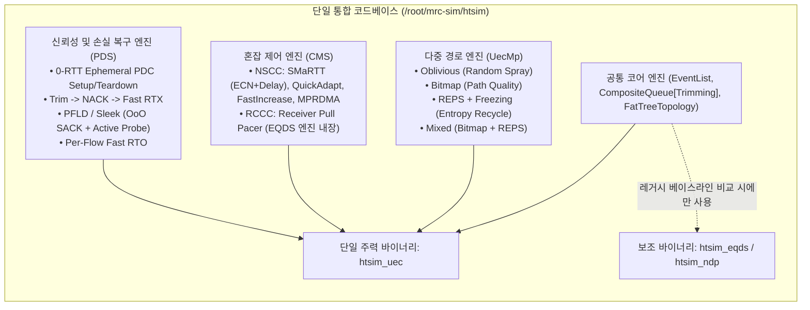
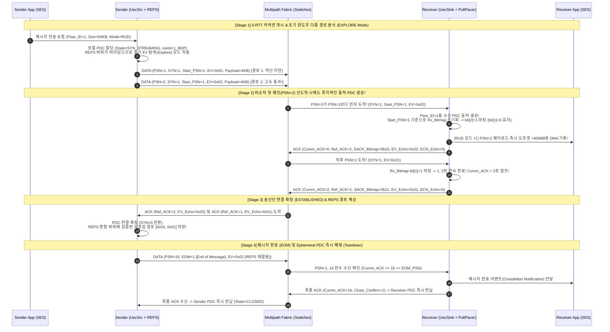
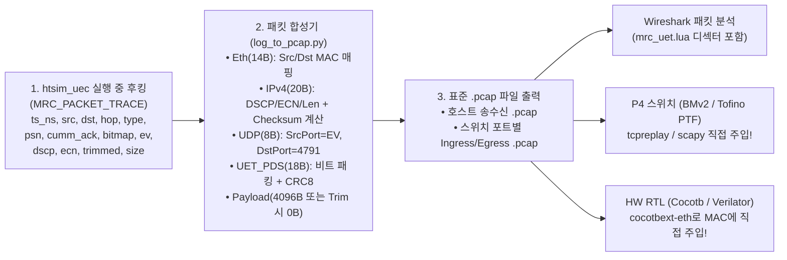

# Multipath Reliable Connection (MRC) 시뮬레이션 아키텍처 및 전 기능 테스트 명세서 (SPEC.md)

> **문서 목적**: `htsim` 기반의 차세대 AI/HPC 데이터센터 네트워크 전송 프로토콜(UEC/UET, SMaRTT/NSCC, RCCC/EQDS, REPS, PFLD/Sleek)을 활용하여 **Multipath Reliable Connection(다중 경로 신뢰성 연결)**의 전 생애주기(0-RTT 커넥션 셋업 → 다중 경로 적응형 전송 → 혼잡/장애 감지 → 패킷 트리밍 및 NACK/Probing → 타 경로 자동 재전송 → 커넥션 종료)를 **단일 통합 시뮬레이션 환경**에서 구축·검증하고, 이를 **P4 프로그래밍 및 하드웨어(FPGA/SmartNIC/ASIC) 구현**으로 직결하기 위한 종합 기술 명세서입니다.

---

## 0. 본 명세서(`SPEC.md`) 수립을 위한 질문 및 설계 진화 히스토리 (Chronological Inquiry Log)

본 문서는 아래 8단계의 핵심 질문과 기술 검토를 거쳐 완성되었습니다:

1. **[질문 1 — 초기 범위 설정 및 커넥션 셋업·이벤트별 패킷 가시화 요청]**
   > *"htsim을 이용해서 multipath reliable connection의 모든 통신을 시뮬레이션 할 수 있다고 들었음. 현재 목적(Multipath + Packet Trimming + NACK/재전송 + 링크 장애 우회)에 가장 적합한 최신 버전은 Broadcom / UEC 워킹그룹에서 공개한 csg-htsim이고 UEC / Smartt (htsim_uec): 다중 경로 엔트로피(Path ID / EV) 기반 전송, REPS(장애/혼잡 경로 회피 스케줄링), 스위치 Packet Trimming, Receiver NACK, 타 경로 자동 재전송과 EQDS / NDP (htsim_eqds, htsim_ndp): Receiver-driven Pull + Trimming 프로토콜 동작 방법을 볼 수 있음. 내가 놓친부분이 있는지 그리고 또 최신정보로 앞으로 계속 연구되고 진행되고 있는 내용을 모두 포함해서 내가 원하는 동작을 확인할 수 있는 시뮬레이션 환경을 구축하고 테스트 시나리오를 자동화해서 실제 어떤 이벤트가 발생하고 각 이벤트 발생시 어떻게 패킷이 보이는지를 설명해줘. 커넥션 셋업 과정에 대해서는 아직 나도 잘 모르기 때문에 처음부터 자세한 설명이 들어가면 좋음. 위 내용을 바탕으로 SPEC.md 파일을 만들어줘"*
   * **반영 위치**: **제2장**(최신 연구 동향 PFLD/Freezing/RCCC 보완), **제3장**(0-RTT Ephemeral PDC 커넥션 셋업 4단계 상세 해설), **제4장**(이벤트별 실제 패킷 헤더 변화 Wire View)

2. **[질문 2 — 시뮬레이션 바이너리 통합 여부 및 최신 MRC 기능 완전성 재확인]**
   > *"현재 다른 두개의 시뮬레이션 바이너리를 받아서 테스트를 하는가 아니면 합쳐서 하는가? 그리고 최신 MRC 기능에 대해서 모든 기능과 테스트 방법이 다 포함 되어 있는지 다시 확인해줘."*
   * **반영 위치**: **제1장**(단일 상위호환 코드베이스 + `htsim_uec` 단일 통합 바이너리 아키텍처 확정), **제2.1절** & **제5장**(28대 세부 기능 및 코너 케이스 전수 매핑)

3. **[질문 3 — SONiC 스위치 MRC 구현 코드와의 비교 및 ASIC 레벨 코너 케이스 확인]**
   > *"sonic 에서 이미 MRC를 지원하는 코드가 이미 개발되어 있음. sonic 코드에는 지금 내가 검증하고자 하는 내용이 모두 포함되어 있는가? 아니면 더 상세한 corner case까지도 고려되어 있는가?"*
   * **반영 위치**: **제2.2절** & **제5장 `[TC-09]`**(SONiC 스위치 영역과 호스트 NIC 영역의 역할 분담 규명 + SONiC/SAI의 6대 하드웨어 코너 케이스 `DROPDTT` Trim 큐 오버플로우, Double-Trim 방지, 소형 패킷 절단 예외, Symmetric/Asymmetric DSCP, L3/L4 Length 갱신, SONiC ARS vs. REPS 통합)

4. **[질문 4 — NIC 중심 아키텍처에서 네트워크 장치(스위치) 중심 아키텍처로의 회귀 가능성]**
   > *"현재 MRC는 NIC 중심의 AI 네트워크라면 네트워크 장치 중심의 네트워크로 다시 회귀할 가능성은 없는가?"*
   * **반영 위치**: **제2.3절**(순수 스위치 중심에서 NIC 중심으로 이동한 이유와, 1-RTT 지연 한계를 극복하기 위해 다시 복귀 중인 4대 스위치 중심 기술 `BTS 직접 반사`, `SONiC ARS/DLB`, `LLR+CBFC`, `In-Network Computing` 및 Scale-Up vs. Scale-Out 이원화 전망)

5. **[질문 5 — 모든 테스트 항목의 출처, 설계 분류(초기 설계 / 코너 케이스 / 스위치 센트릭), 해결 로직 명시]**
   > *"모든 테스트 내용에 출처가 들어가 있으면 좋겠음. 이미 초기 설계시에 고려된 것인가 코너케이스인가 또는 스위치 센트릭 시도인가. 어떤 로직이 문제를 해결한 것인지 확인하고자함."*
   * **반영 위치**: **제2.1절** 및 **제5장 전 시나리오**에 `🟢 [초기 설계]`, `🟡 [코너 케이스 보완]`, `🔵 [스위치 센트릭 시도]` 태그와 논문/표준/소스코드 출처 및 해결 함수/알고리즘 명시

6. **[질문 6 — P4 프로그래밍 및 하드웨어(FPGA/ASIC) 구현을 위한 최종 리뷰]**
   > *"전체 내용을 분석하고 빠진부분이 있는지 최종 리뷰를 부탁함. 테스트 내용을 바탕으로 p4 프로그래밍과 하드웨어로 구현할 예정임."*
   * **반영 위치**: **제6장 (`6.1 ~ 6.4절`)**(`htsim` C++ 시뮬레이터와 실제 P4/RTL 하드웨어 간의 7대 간극 `H-1 ~ H-7`, 64-Byte 비트 정합 헤더 레이아웃, P4 `truncate()` 참조 코드, 1-Cycle REPS 링 버퍼 및 `CTO` 비트맵 시프터 RTL 블록도)

7. **[질문 7 — 시뮬레이션 테스트 로그의 `.pcap` 변환 가능 여부]**
   > *"테스트 로그를 pcap으로 변환이 가능한가?"*
   * **반영 위치**: **제6.5절** & **`[TC-10]`**(`MRC_PACKET_TRACE` 로그를 스위치 입력용/출력용/전체 왕복용 3종 표준 `.pcap` 및 AXI-Stream `.tv` 골든 벡터로 합성하는 파이프라인 및 Wireshark Lua 디섹터 `mrc_uet.lua` 명세)

8. **[질문 8 — 실행 단계 요약의 테스트 시나리오 범위(`TC-01 ~ TC-10`) 및 문서 전체 정합성 확인]**
   > *"실행 단계 요약에 TC-01에서 TC-10 까지라고 이야기 하지 않는데 왜 TC-05 까지만 이야기 하고 있나? 전체적인 문서의 정합성을 다시 확인해줘"*
   * **반영 위치**: **제1장, 제5장, 제6장, 제7장, 제8장** 전 구간의 시나리오 범위를 `TC-01 ~ TC-10`으로 일치시키고, **제8장**을 `Phase 1 ~ Phase 5` (`TC-01 ~ TC-10` 전 과정 포함) 상세 실행 로드맵 표로 완비

---

## 1. 시뮬레이터 실행 구조: 분리 실행 vs. 통합 실행 아키텍처 (Unified Architecture Decision)

질문자님께서 확인 요청하신 **"다른 두 개의 시뮬레이션 바이너리(저장소)를 따로 받아서 테스트하는가, 아니면 합쳐서 하는가?"**에 대한 아키텍처 결론부터 명확히 정리합니다.

### 1.1. 핵심 결론: **단일 통합 코드베이스 + 단일 주력 바이너리(`htsim_uec`)로 통합하여 테스트합니다**

이유는 **저장소(Repository) 계층**과 **바이너리(Executable) 계층** 두 가지 관점에서 설명할 수 있습니다.

#### ① 바이너리 관점: `htsim_uec` 하나에 이미 Sender-driven(SMaRTT)과 Receiver-driven(EQDS Pull)이 합쳐져 있습니다
초기 연구 단계에서는 프로토콜별로 바이너리가 완전히 나뉘어 있었습니다(`htsim_ndp` $\rightarrow$ `htsim_eqds` $\rightarrow$ `htsim_uec`). 그러나 UEC(Ultra Ethernet Consortium) 표준화 과정에서 Broadcom의 **EQDS(Receiver-driven Pull + Trimming)** 기술과 학계/워킹그룹의 **SMaRTT(Sender-driven ECN/Delay/Trimming) + REPS** 기술이 **`htsim_uec` 바이너리 내부로 완전히 통합**되었습니다.

즉, **`htsim_uec` 단일 바이너리** 안에서 실행 옵션(CLI 플래그)만 바꾸면 아래 3가지 모드가 모두 동작합니다:

| 동작 모드 (`htsim_uec` 내장) | 프로토콜적 의미 | 활성화 CLI 플래그 | 비고 |
| :--- | :--- | :--- | :--- |
| **1) NSCC-Only 모드** (Sender-driven) | **SMaRTT / MPRDMA** (송신단이 ECN + RTT Delay + Trimming/NACK 신호로 `cwnd` 직접 제어) | `-sender_cc_only` | 가장 보편적인 고성능 저지연 모드 |
| **2) RCCC-Only 모드** (Receiver-driven) | **EQDS 방식** (초기 1 BDP만 즉시 전송 후, 수신단 `UecPullPacer`가 발행하는 `PULL` 크레딧 패킷으로 송신단 전송 제어) | 기본값 (또는 `-receiver_cc_only`) | 대규모 Incast 및 Oversubscribed 토폴로지 특화 |
| **3) Dual Hybrid 모드** (NSCC + RCCC 통합) | **UEC 풀 스펙 (CMS 통합)**: 네트워크 내부(Fabric) 병목은 송신단 NSCC가 제어하고, 수신단 마지막 홉(Last-hop Incast) 병목은 수신단 RCCC(Pull)가 동시에 제어 | `-sender_cc` (NSCC와 RCCC 동시 활성화) | UEC 표준이 지향하는 하이브리드 구조 |

> **참고**: 같은 소스 폴더(`sim/datacenter/`)를 빌드하면 레거시 비교용으로 `htsim_eqds`와 `htsim_ndp` 바이너리도 함께 생성되지만, 이들은 **"과거 오리지널 프로토콜과의 벤치마크 비교(Baseline)"**가 필요할 때만 보조로 실행하며, **우리의 모든 핵심 기능 테스트(`TC-01 ~ TC-10`)는 통합된 `htsim_uec` 바이너리 하나로 수행**합니다.

#### ② 저장소(Repository) 관점: `spcl/HTSIM` (UEC 확장판)을 베이스로 한 **단일 통합 소스 트리** 운영
* `Broadcom/csg-htsim`이 초기 베이스라인이고, `ultraethernet/uet-htsim` 및 ETH Zurich의 `spcl/HTSIM`은 `csg-htsim`을 포크(Fork)하여 그 위에 **최신 UEC 기능(4종 멀티패스 알고리즘 `oblivious`/`bitmap`/`reps`/`mixed`, REPS Freezing, PFLD/Sleek 프로브 기반 손실 복구, SMaRTT 세부 변종 등)**을 모두 추가한 **상위 호환(Superset) 저장소**입니다. (이 안에 기존 `eqds`, `ndp` 코드도 그대로 포함되어 있습니다.)
* 따라서 두 개의 저장소를 따로 두고 관리할 필요 없이, **최신 상위 호환 코드베이스 하나를 `/root/mrc-sim/htsim` 단일 트리로 구성하고 여기에 통합 패킷 트레이서(`MRC_PACKET_TRACE`)를 이식**하여 모든 시나리오를 일관되게 테스트합니다.



---

## 2. 최신 MRC (Multipath Reliable Connection) 전 기능 완전성 점검표 (Full Feature Audit & Provenance)

놓친 기능이 없는지 재확인하고 각 기술이 **왜 등장했는지** 명확히 추적하기 위해, 모든 기능에 대해 다음 **4가지 추적 메타데이터**를 명시했습니다:
1. **설계 분류 태그**:
   * 🟢 **`[초기 설계 (Foundational Design)]`**: 프로토콜(NDP, EQDS, UET 1.0, SMaRTT, REPS) 최초 아키텍처 설계 시점부터 기본 동작으로 정의된 핵심 기능
   * 🟡 **`[코너 케이스 보완 (Corner-Case Mitigation)]`**: 초기 설계를 실제 대규모 클러스터나 스위치 ASIC에 적용했을 때 드러난 치명적 예외 상황(패킷 역전, Trimming 유실, 블랙홀, Tail Loss, 이중 절단 등)을 해결하기 위해 추가된 방어 로직
   * 🔵 **`[스위치 센트릭 시도 (Switch-Centric Evolution)]`**: 순수 호스트(NIC) 중심 제어의 물리적 한계(최소 1-RTT 지연)를 극복하기 위해 스위치 ASIC/SONiC이 직접 판단·개입하도록 도입된 네트워크 장치 중심 기법
2. **명확한 기술 출처 (Origin / Reference)**: 표준 문서(UEC UET Spec), 학술 논문(SIGCOMM/NSDI/EuroSys/arXiv), 오픈소스 코드(`Broadcom/csg-htsim`, `spcl/HTSIM`, `sonic-swss`, `SAI`)
3. **기존 문제점 (Problem)**: 해당 로직이 없을 때 발생하는 장애 또는 성능 저하 현상
4. **해결한 핵심 로직 (Solving Logic)**: 문제를 해결하는 구체적인 알고리즘 및 코드 내 함수/상태 변수

### 2.1. 영역별 28대 세부 기능 출처·분류·해결 로직 매트릭스

| 기능 ID 및 명칭 | 설계 분류 | 기술 출처 (표준 / 논문 / 코드) | 해결하고자 한 문제 & 문제를 해결한 핵심 로직 (`htsim` / SONiC SAI) | 검증 시나리오 |
| :--- | :--- | :--- | :--- | :--- |
| **A-1. 0-RTT Ephemeral PDC 셋업** | 🟢 `[초기 설계]` | • **UEC UET Spec v1.0 (PDS 계층)**<br/>• `csg-htsim`: `uec.cpp` (`UecSrc::startflow`) | **[문제]** 수만 GPU All-to-All 통신 시 TCP 3-Way Handshake(1~2 RTT 지연) 및 RoCEv2 영구 QP 메모리 폭발 발생.<br/>**[해결 로직]** 사전 핸드셰이크를 제거하고 첫 데이터 패킷 헤더에 `SYN=1` 및 `Initiator_PDC_ID`를 실어 즉시 전송(`send_packets()`). 수신단(`UecSink::receivePacket`)은 첫 패킷 도착 즉시 동적으로 PDC 컨텍스트를 생성하여 0-RTT 연결 수립. | **TC-01** |
| **A-2. 초기 패킷 역전 도착 (OoO SYN) 처리** | 🟡 `[코너 케이스 보완]` | • **UEC UET Spec v1.0 (PDS Dynamic PDC)**<br/>• `spcl/HTSIM`: `uec.cpp` (`UecSink` bitmap init) | **[문제]** 첫 패킷부터 다중 경로로 뿌리다 보니 `PSN=1`보다 `PSN=2`가 수신단에 먼저 도착하여 연결 초기화 기준점을 잃는 코너 케이스.<br/>**[해결 로직]** 첫 윈도우 패킷들에 `SYN=1`과 함께 메시지 시작 번호(`Start_PSN=1`)를 명시. `UecSink`는 `PSN=2`가 먼저 도착해도 `Start_PSN=1`을 기준으로 `_cumulative_ack=0`으로 세팅하고 `_ooo_bitmap`의 2번 비트를 먼저 `1`로 마킹한 뒤 즉시 `SACK` 회신. | **TC-01** |
| **A-3. Unscheduled (Speculative) 초기 전송** | 🟢 `[초기 설계]` | • **NDP (SIGCOMM'17)** / **Broadcom EQDS**<br/>• **UEC RCCC Spec** (`uec.cpp` `_unscheduled_bytes`) | **[문제]** 순수 Receiver-driven Pull 방식에서는 수신단이 `PULL`을 보낼 때까지 송신단이 대기하면 1 RTT가 낭비됨.<br/>**[해결 로직]** 첫 1 BDP(`_bdp`) 분량은 Pull 크레딧 없이도 `Unscheduled Data` + `UecRtsPacket`으로 즉시 발사하고, 이후 바이트부터 수신단 `UecPullPacer`가 크레딧 스케줄링 수행. | **TC-06** |
| **A-4. Ephemeral Teardown (EOM & PDC 즉시 해제)** | 🟢 `[초기 설계]` | • **UEC UET Spec v1.0 (PDS Close)**<br/>• `uec.cpp` (`UecSrc::processAck` `_done`) | **[문제]** 전송 완료 후에도 연결 상태(PDC)를 계속 유지하면 NIC 온칩 SRAM 고갈.<br/>**[해결 로직]** 마지막 데이터 패킷에 `EOM=1` 플래그 부착. 수신단이 `1..EOM_PSN`까지 빠짐없이 수신하여 `cumulative_ack == flow_size`에 도달하면 완료 ACK 발송 직후 송·수신 PDC 리소스를 풀(Pool)로 즉시 반납. | **TC-01** |
| **B-1. Oblivious Packet Spraying** | 🟢 `[초기 설계]` | • **RPS (INFOCOM'13)** / **NDP (SIGCOMM'17)**<br/>• `uec_mp.cpp` (`UecMpOblivious::nextEntropy`) | **[문제]** 기존 단일 경로 ECMP(5-tuple 해싱)는 대용량 AI 플로우(Elephant Flow)들이 같은 링크에 겹치는 해시 충돌(Hash Polarization) 유발.<br/>**[해결 로직]** `UecMpOblivious`가 매 패킷마다 랜덤/순차적으로 `pathid(EV)`를 변경하여 모든 스위치 업링크로 패킷을 균등 분사. | **TC-04** |
| **B-2. Bitmap 기반 경로 품질 추적** | 🟡 `[코너 케이스 보완]` | • **Broadcom / UEC WG 초기 제안**<br/>• `uec_mp.cpp` (`UecMpBitmap::nextEntropy`) | **[문제]** 무작위 스프레잉(`Oblivious`)은 특정 경로에 장애나 혼잡이 생겨도 그 경로로 계속 패킷을 보내 손실을 유발.<br/>**[해결 로직]** 송신단에 경로 수만큼의 상태 배열/비트맵(`_path_penalties`)을 두고, `NACK`이나 `ECN=1`이 발생한 `EV` 인덱스에 패널티를 부여해 다음 순환 시 건너뜀(`UecMpBitmap::processEv`). | **TC-04** |
| **B-3. REPS (Recycled Entropy Packet Spraying)** | 🟢 `[초기 설계]` | • **REPS 논문 (ETH SPCL / Broadcom / MS, 2024–2025)**<br/>• **UEC CMS 권장 표준** (`UecMpReps`) | **[문제]** 수천 개 경로를 비트맵으로 관리하면 NIC 메모리 소모가 크고, 스위치 해시 함수를 호스트가 알 수 없음.<br/>**[해결 로직]** 단지 ~25 Bytes 크기의 작은 **환형 버퍼(`_circular_buffer_reps`)**만 두고, 수신단 `ACK`에 에코되어 돌아온 `ev_echo` 중 **혼잡이 없었던(`ecn_echo == 0`) `EV` 값만 버퍼에 Push**한 뒤 다음 전송/재전송 패킷의 `pathid`로 Pop하여 재활용(`UecMpReps::nextEntropy`). | **TC-01, 02, 04** |
| **B-4. REPS Freezing Mode & ARCANE 탐색** | 🟡 `[코너 케이스 보완]` | • **REPS & ARCANE 논문 (ETH SPCL, 2025–2026)**<br/>• `spcl/HTSIM`: `uec_mp.cpp` (`_is_freezing`) | **[문제]** 갑작스러운 다수 링크 단절(Link Failure)이나 중대 혼잡 발생 시, `ECN=0`인 `ACK`가 끊겨 REPS 환형 버퍼가 고갈되거나 과거의 죽은 경로를 참조하는 코너 케이스.<br/>**[해결 로직]** 손실 급증 또는 유효 EV 고갈 감지 시 **`enter_freezing()`(Freezing Mode)**을 발동하여 일정 시간(`_freezing_duration`) 동안 버퍼 갱신/변동을 제어하고 새로운 랜덤 EV를 적극 탐색(Exploration)해 1~2 RTT 내에 살아있는 경로만으로 버퍼를 재구축. | **TC-04, 05** |
| **B-5. Mixed (Bitmap + REPS 하이브리드)** | 🟡 `[코너 케이스 보완]` | • `csg-htsim` / `spcl/HTSIM`<br/>• `uec_mp.cpp` (`UecMpMixed`) | **[문제]** 플로우 초기(Cold Start)나 급변 구간에서 순수 REPS의 탐색 오버헤드와 Bitmap의 메모리 한계를 절충할 필요.<br/>**[해결 로직]** `UecMpMixed` 클래스가 기본 경로 필터링은 Bitmap으로 수행하면서 검증된 우량 경로는 REPS 큐로 우선 공급. | **TC-04** |
| **C-1. 스위치 Packet Trimming & Queue Jumping** | 🟢 `[초기 설계]` | • **CP (NSDI'14)** / **NDP (SIGCOMM'17)** / **UEC 1.0**<br/>• `compositequeue.cpp` (`CompositeQueue::receivePacket`) | **[문제]** 스위치 버퍼가 꽉 찼을 때 패킷을 그냥 버리면(Tail-drop), 수신단은 패킷 손실 사실을 몰라 느린 RTO 타임아웃까지 대기해야 함.<br/>**[해결 로직]** `_low_prio_queue` 오버플로우 시 `pkt.strip_payload()`를 호출해 4096B 페이로드를 제거하고 **64B 헤더(`trimmed=true`)로 축소**한 뒤, **고우선순위 제어 큐(`_high_prio_queue`)로 승격**시켜 앞선 데이터 패킷들을 추월(Queue Jumping)해 수신단에 즉시 전달. | **TC-02** |
| **C-2. 즉시 선택적 NACK & REPS 타 경로 고속 재전송** | 🟢 `[초기 설계]` | • **NDP / EQDS / UEC PDS & CMS Spec**<br/>• `uec.cpp` (`UecSink::send_nack`, `UecSrc::processNack`) | **[문제]** 손실이 발생한 바로 그 경로(`EV`)로 재전송 패킷을 다시 보내면 또 막혀서 연쇄 손실 발생.<br/>**[해결 로직]** 수신단이 `pkt.header_only()` 감지 즉시 `UecNackPacket(ref_epsn, ev_discarded)` 발송. 송신단 `processNack()`은 해당 패킷을 `_rtx_queue` 최상단에 넣고, 실패한 `ev_discarded`를 버린 뒤 **`UecMpReps::nextEntropy()`에서 검증된 건강한 다른 `EV`를 꺼내어 즉시 재전송**. | **TC-02** |
| **C-3. 비순차(OoO) SACK 비트맵 & 홀 메우기** | 🟢 `[초기 설계]` | • **UEC PDS Spec** / **EQDS**<br/>• `uec.cpp` (`UecSink::_epsn`, `_ooo_bitmap`) | **[문제]** 다중 경로 전송 시 필연적으로 패킷 순서가 뒤바뀌는데, RoCEv2처럼 순서 어긋남을 손실로 판정하면 Go-Back-N 폭풍 발생.<br/>**[해결 로직]** 수신단은 순서가 어긋난 정상 데이터 패킷에 대해서는 **절대 NACK을 보내지 않고** 수신 버퍼 및 64비트 `_ooo_bitmap`에 마킹 후 `SACK`만 회신. 나중에 Trimming 되었던 번호(`PSN=k`)의 재전송 패킷이 도착해 구멍(Hole)이 메워지면 `_cumulative_ack`를 연속된 비트만큼 단번에 점프. | **TC-02, 03** |
| **C-4. PFLD / Sleek (Trimming 유실 / Silent Drop 복구)** | 🟡 `[코너 케이스 보완]` | • **PFLD / Sleek 논문 (ETH SPCL / MS, 2024–2025)**<br/>• `spcl/HTSIM`: `uec.cpp` (`_sleek`, probe logic) | **[문제]** **[치명적 코너 케이스]** 물리적 링크 단절(Blackhole)이나 스위치 제어 큐 포화(`DROPDTT`)로 인해 **Trimmed 패킷조차 증발**하면, 수신단은 패킷의 존재 자체를 몰라 `NACK`을 영원히 보내지 못함!<br/>**[해결 로직]** 송신단이 (1) 미확인 패킷(`PSN=k`) 이후에 출발한 다른 경로 패킷들의 `SACK`가 임계치(`_ooo_threshold`) 이상 도착했음을 감지하거나, (2) 능동적으로 건강한 REPS 경로를 통해 **64B `Probe` 패킷**을 발사하여 수신단 비트맵 검사를 트리거함으로써 **NACK 없이도 1~1.5 RTT 내에 Silent Drop을 찾아내 재전송**. | **TC-05, 09** |
| **C-5. Tail Packet Loss (마지막 EOM 패킷 손실) 복구** | 🟡 `[코너 케이스 보완]` | • **PFLD / UEC PDS Control Packet Spec**<br/>• `uec.cpp` (`rtx_timer_hook`, Tail Probe) | **[문제]** **[코너 케이스]** 플로우의 맨 마지막 패킷(`PSN=N, EOM=1`)이 블랙홀에서 유실되면, 뒤따라오는 `PSN=N+1` 패킷이 아예 없으므로 SACK 역전(OoO 카운트)도 발생하지 않아 플로우가 끝에서 멈추는(Hang) 현상.<br/>**[해결 로직]** 송신단이 마지막 패킷(`_highest_sent == _flow_size`) 전송 후 1~2 RTT 동안 누적 ACK가 완료되지 않으면 즉시 **Tail Probe / Fast Tail RTO**를 발동해 건강한 REPS 경로로 마지막 패킷을 즉시 재전송. | **TC-03, 05** |
| **C-6. 재전송 패킷의 재손실 (RTX-of-RTX) 방어** | 🟡 `[코너 케이스 보완]` | • **UEC PDS Retransmission Tracking**<br/>• `uec.cpp` (`_rtx_times`, `_rtx_queue`) | **[문제]** **[코너 케이스]** 극심한 Incast 시 재전송한 패킷(`rtx=1`)마저 다른 경로에서 또 Trimming/드랍되거나, 동일 PSN에 대해 중복 NACK이 날아올 때 상태가 꼬이는 문제.<br/>**[해결 로직]** 패킷별 재전송 횟수(`_rtx_times[psn]`)와 최근 재전송 시각을 기록하여 1 RTT 이내의 중복 NACK은 억제(Suppression)하되, 재전송된 패킷 자체가 새로 Trimming되어 돌아온 `NACK`은 정확히 식별하여 제3의 REPS 경로로 2차 재전송(`rtx=2`) 수행. | **TC-03** |
| **D-1. SMaRTT 멀티 시그널 제어 (ECN + RTT Delay)** | 🟢 `[초기 설계]` | • **SMaRTT 논문 (ETH SPCL / Broadcom, 2024)**<br/>• **UEC NSCC Spec** (`UecSrc::adjust_window`) | **[문제]** ECN만 쓰면 RTT 지연 변화에 둔감하고, Delay(Swift)만 쓰면 멀티패스 경로별 지연 편차에 오작동함.<br/>**[해결 로직]** `ACK` 수신 시 `(1) ecn_echo` 여부와 `(2) 측정 RTT vs target_rtt` 두 신호를 4가지 케이스(`ECN=0 & Delay<T`, `ECN=1 & Delay<T`, `ECN=0 & Delay>T`, `ECN=1 & Delay>T`)로 나누어 곱셈 감소(MD)와 선형 증가(AI) 폭을 정밀 조절. | **TC-07** |
| **D-2. QuickAdapt (급격한 혼잡 시 1-RTT 즉시 감속)** | 🟡 `[코너 케이스 보완]` | • **SMaRTT / UEC NSCC QuickAdapt**<br/>• `uec.cpp` (`UecSrc::quick_adapt`) | **[문제]** 대규모 Incast(예: 32:1)가 갑자기 시작되면 일반 Multiplicative Decrease로는 `cwnd`가 줄어드는 속도가 너무 느려 수백 개의 패킷이 연쇄 Trimming됨.<br/>**[해결 로직]** Trimming(`NACK`) 발생 또는 RTT가 `qa_threshold`를 초과하면 **`quick_adapt()`**가 작동하여, 지난 1 기준 RTT 동안 **실제로 수신단에 무사히 도착한 바이트 수(`_achieved_bytes`)**로 `_cwnd`를 단번에 덮어씌워(`_cwnd = max(_achieved_bytes, _min_cwnd)`) 즉시 큐 폭주를 진압. | **TC-02, 07** |
| **D-3. Fast Increase (무혼잡 구간 고속 대역폭 획득)** | 🟡 `[코너 케이스 보완]` | • **SMaRTT / UEC NSCC FastIncrease**<br/>• `uec.cpp` (`UecSrc::fast_increase`) | **[문제]** QuickAdapt로 윈도우를 크게 줄인 직후 경쟁 플로우가 끝나 링크가 비어도, 일반 Additive Increase로는 400G/800G 대역폭을 다시 채우는 데 수십 RTT가 걸림.<br/>**[해결 로직]** 한 RTT 전체 구간 동안 도착한 모든 `ACK`에서 `ecn_echo == 0`이고 손실이 0건이면 **`fast_increase()`** 모드로 진입하여 패킷당 증가량을 배가시켜 유휴 대역폭을 수 RTT 내에 즉시 회복. | **TC-07** |
| **D-4. RCCC (Receiver-driven Credit / Pull Pacing)** | 🟢 `[초기 설계]` | • **NDP (SIGCOMM'17)** / **Broadcom EQDS**<br/>• **UEC RCCC Spec** (`UecPullPacer`, `eqds.cpp`) | **[문제]** 다수의 송신자가 동시에 한 수신자로 쏘는 마지막 홉(Last-hop ToR Downlink) Incast는 송신단끼리 서로의 존재를 몰라 첫 RTT 충돌을 피할 수 없음.<br/>**[해결 로직]** 수신단 NIC의 단일 **`UecPullPacer`**가 모든 송신자들로부터 온 요청(`RTS`/Unscheduled)을 통합 큐에 넣고, **수신단 링크 속도(Line-rate)에 정확히 맞춘 간격으로 `UecPullPacket(pull_no)`을 하나씩 발행**하여 수신 포트 오버플로우를 근본 차단. | **TC-06, 08** |
| **D-5. CSIG (Congestion Signaling 스위치 텔레메트리)** | 🔵 `[스위치 센트릭 시도]` | • **UEC 1.0/1.1 CSIG Spec** / **Google/Broadcom CSIG**<br/>• `uecpacket.h` telemetry fields | **[문제]** 1비트 ECN(`0` 또는 `1`)만으로는 스위치 큐가 얼마나 찼는지, 병목 링크 대역폭이 얼마인지 정량적으로 알 수 없음.<br/>**[해결 로직]** 패킷이 스위치를 통과할 때 스위치 ASIC이 현재 큐 점유율/최대 병목 지표를 헤더(CSIG 태그)에 직접 스탬핑하고, 수신단이 이를 `ACK`로 반사하여 송신단 NSCC가 정확한 비율로 속도를 조절. | **TC-07** |
| **E-1. 배달 보장 모드 (ROD vs. RUD)** | 🟢 `[초기 설계]` | • **UEC UET Spec v1.0 (PDS Delivery Modes)**<br/>• `uec.cpp` (`UecSink` delivery tracking) | **[문제]** AI 학습의 RDMA Write(텐서 복사)는 패킷 도착 순서와 무관하게 메모리 번지에 바로 쓸 수 있는데도, 전통 프로토콜은 1번 패킷이 늦으면 뒤따른 패킷들을 모두 버퍼에 묶어두는 HoL(Head-of-Line) 블로킹 유발.<br/>**[해결 로직]** **RUD(Reliable Unordered Delivery)** 모드에서는 패킷 도착 즉시 상위 메모리에 DMA 반영하고 비트맵만 채워 완료 처리하며, 순서가 필수적인 제어 메시지에만 **ROD(Reliable Ordered Delivery)** 재정렬 버퍼 적용. | **TC-01, 02** |
| **E-2. 비대칭(Asymmetric) & 장애 토폴로지 적응** | 🟡 `[코너 케이스 보완]` | • **REPS / SMaRTT 논문** (`FatTreeTopology`) | **[문제]** 실무 데이터센터에서는 광모듈 노후화나 케이블 단절로 인해 일부 Spine 경로의 대역폭이 줄어드는 비대칭 토폴로지(Asymmetric Fabric)가 상시 발생.<br/>**[해결 로직]** 느려지거나 끊긴 경로에서는 `ACK`가 덜 오거나 `ECN=1`이 찍히므로, REPS 환형 버퍼에 들어가는 건강한 `EV`의 비율이 **각 경로의 실제 잔여 대역폭에 정확히 비례하여 자동 가중치 조절(Weighted Fair Spraying)**됨. | **TC-04, 08** |
| **F-1. Trim Queue 포화 드랍 (`DROPDTT` / Trim Drop)** | 🟡 `[코너 케이스 보완]` | • **SONiC Packet Trimming HLD** & **SAI v1.14+**<br/>• `saibuffer.h` (`SAI_QUEUE_STAT_DROPPED_TRIM_PACKETS`) | **[문제]** **[SONiC ASIC 코너 케이스]** 극심한 Incast 시 수천 개 패킷이 동시에 잘리면서, 64B Trimmed 헤더들이 들어가는 **고우선순위 Trim Queue마저 버퍼 한계를 초과**하여 잘린 헤더조차 드랍(`DROPDTT`)되는 현상.<br/>**[해결 로직]** 스위치(`CompositeQueue`)는 Trim Queue 한계 초과 시 `DROPDTT` 카운터를 증가시키고 패킷을 폐기하며, 이로 인해 수신단이 보내지 못한 `NACK`의 공백은 호스트의 **PFLD(Probe + OoO SACK 카운터, `C-4`) 로직이 이어받아 복구**함. | **TC-05, 09** |
| **F-2. 소형 패킷 Trimming 예외 (`pkt_size <= trim_size`)** | 🟡 `[코너 케이스 보완]` | • **SONiC `sonic-mgmt`** (`tests/packet_trimming`)<br/>• `SWITCH_TRIMMING` `size` rule | **[문제]** **[SONiC ASIC 코너 케이스]** 스위치 Trim 목표 크기가 `128B`(또는 `64B`)인데, 메시지의 마지막 자투리 데이터나 제어 패킷의 원래 크기가 이미 `96B`인 상태로 혼잡 큐에 도착한 경우.<br/>**[해결 로직]** 스위치 Admission 로직에서 `pkt.size() <= trim_size` 조건을 검사하여, 자신보다 작은 패킷을 잘라 패킷을 깨뜨리는 대신 페이로드 절단을 생략하고 DSCP/우선순위 정책만 적용. | **TC-09** |
| **F-3. Trimmable DSCP 식별 및 이중 절단(Double-Trim) 방지** | 🟡 `[코너 케이스 보완]` | • **SONiC Packet Trimming HLD** (`sonic-swss`)<br/>• `SAI_BUFFER_PROFILE_PACKET_ADMISSION_FAIL_ACTION_TRIM` | **[문제]** **[SONiC ASIC 코너 케이스]** (1) BGP/ARP/ACK/NACK 같은 제어 패킷이 잘리면 망이 마비되며, (2) 3-Tier 망에서 앞단 Spine 스위치에서 이미 잘린 패킷(`64B`)이 뒷단 Leaf 스위치에서 또 잘려 카운터와 헤더가 오염되는 문제.<br/>**[해결 로직]** 오직 `Trimmable DSCP`가 부여된 데이터 패킷만 Trimming을 허용하고, 1회 절단 즉시 패킷을 `TRIM_DSCP`(`trimmed=1`)로 리마킹하여 이후 홉 스위치에서는 절단 대상에서 영구 제외(`TX_TRIM_PACKETS` 1회만 증가). | **TC-09** |
| **F-4. L3/L4 Length·Checksum 재작성 & Sym/Asym DSCP** | 🟡 `[코너 케이스 보완]` | • **SONiC `test_packet_trimming_symmetric/asymmetric.py`** | **[문제]** **[SONiC ASIC 코너 케이스]** 페이로드만 자르고 IP 헤더의 `Total Length`를 4160B로 두면 다음 스위치나 수신 NIC에서 L2/L3 길이 불일치 에러로 패킷을 버림.<br/>**[해결 로직]** 스위치 파이프라인이 절단과 동시에 `ip_total_len = trim_size`로 갱신(원래 길이는 UET PDS 헤더의 `orig_len`에 보존)하고, L3 Checksum 재계산 및 Symmetric(단일 DSCP) 또는 Asymmetric(`FROM_TC` 기반 DSCP) 리마킹 수행. | **TC-02, 09** |
| **F-5. 스위치 로컬 적응형 라우팅 (SONiC ARS / DLB)** | 🔵 `[스위치 센트릭 시도]` | • **SONiC ARS HLD** / **Broadcom Tomahawk 5/6 DLB**<br/>• `FatTreeSwitch` adaptive routing | **[문제]** **[스위치 센트릭 시도]** 호스트 REPS는 `ACK`가 돌아오는 1 RTT 동안은 중간 스위치의 돌발 혼잡이나 링크 단절을 알 수 없음.<br/>**[해결 로직]** 스위치 ASIC이 실시간으로 자기 출력 포트들의 큐 부하와 링크 상태를 보고, 호스트가 보낸 `EV` 해시 경로가 막혀 있으면 **스위치 직권으로 가장 한가한 포트로 즉시 우회(0-RTT Local Reroute)**시킴. (단, 호스트 REPS와 동시 사용 시 경로 매핑 간섭 여부를 **TC-09**에서 비교 검증). | **TC-04, 09** |
| **F-6. BTS (Back-to-Sender / FastNACK) 스위치 직접 반사** | 🔵 `[스위치 센트릭 시도]` | • **UEC 1.1 BTS 논의** / **BFC / FastNACK 논문**<br/>• Switch-reflected Trimming mode | **[문제]** **[스위치 센트릭 시도]** 잘린 패킷을 수신단까지 보냈다가(FTD) 수신단이 NACK을 보내면 송신단이 알기까지 1 RTT가 걸림.<br/>**[해결 로직]** 혼잡 스위치(예: ToR/Spine)가 패킷을 자른 즉시 **수신단으로 보내는 대신(또는 보내면서 동시에) Src/Dst 주소를 뒤집어 송신단으로 직접 반사(Reflect)**함으로써 재전송 및 감속 반응 시간을 **0.2~0.5 RTT**로 단축. | **TC-09** |

---

## 2.2. 심층 분석: SONiC의 MRC 구현 코드 vs. `htsim` End-to-End 시뮬레이션의 차이점 및 상호보완성

> **핵심 질문**: *"SONiC에서 이미 MRC를 지원하는 코드가 개발되어 있는데, SONiC 코드에 지금 내가 검증하고자 하는 내용이 모두 포함되어 있는가? 아니면 더 상세한 Corner Case까지 고려되어 있는가?"*

이 질문에 대한 기술적 해답은 다음 **두 가지 명제**로 요약됩니다:

1. **SONiC 코드는 "스위치(NOS/ASIC) 내부 동작"만 담당하므로, 질문자님이 검증하려는 "End-to-End MRC 프로토콜(호스트 NIC의 커넥션 셋업, NACK 생성, REPS 엔트로피 재활용, 타 경로 재전송, Pull Pacing)"은 SONiC 코드에 포함되어 있지 않습니다.**
2. **반면, "스위치 내부에서 패킷을 자르고(Trimming) 포워딩하는 하드웨어 파이프라인 동작"에 한해서는 SONiC(`sonic-swss` / `SAI` / `sonic-mgmt`) 코드가 학술 시뮬레이터보다 훨씬 더 까다로운 실제 ASIC 레벨의 Corner Case들을 고려하고 있습니다.**

### ① SONiC 코드에 있는 것 vs. 없는 것 (역할 분담 구조)

```
┌───────────────────────────┐         ┌───────────────────────────┐         ┌───────────────────────────┐
│   Sender Host (AI NIC)    │         │   SONiC Switch (TH5/TH6)  │         │  Receiver Host (AI NIC)   │
│  [SONiC에 없음 -> htsim]   │         │  [SONiC/SAI에 구현됨!]     │         │  [SONiC에 없음 -> htsim]   │
├───────────────────────────┤         ├───────────────────────────┤         ├───────────────────────────┤
│ • 0-RTT Ephemeral PDC 셋업 │ 4KB Data│ • Trimmable DSCP 분류     │ 64B Trim│ • 동적 PDC 생성 (OoO SYN) │
│ • REPS 환형 버퍼 & EV 선택 │────────>│ • Buffer Admission Check  │────────>│ • Trimmed 헤더 감지       │
│ • SMaRTT (cwnd, QuickAdapt)│ (DSCP_A)│ • Payload 절단 (128B/64B) │ (DSCP_T)│ • 즉시 NACK 생성 및 발송   │
│ • NACK 수신 -> 타 경로 RTX │<────────│ • DSCP Remark & Trim Q승격│<────────│ • OoO SACK 비트맵 & 버퍼   │
│ • PFLD/Sleek Probe & RTO  │ 64B NACK│ • ARS / DLB & ECN/CSIG    │ 64B NACK│ • RCCC Pull Pacer 크레딧  │
└───────────────────────────┘         └───────────────────────────┘         └───────────────────────────┘
```

* **SONiC만으로 검증 불가능한 영역**: SONiC의 테스트 프레임워크(`sonic-mgmt/tests/packet_trimming`)는 파이썬 PTF(Packet Test Framework)로 스위치 포트에 더미 패킷을 쏘고 **스위치 반대편 포트에서 패킷 크기가 줄어들어 나왔는지, DSCP 값이 바뀌었는지, SAI 카운터가 올라갔는지만 단방향(One-hop stateless)으로 검사**합니다. 즉, 잘린 패킷을 받은 수신단이 `NACK`을 보내고 송신단이 `REPS`로 다른 경로를 골라 재전송하여 메시지가 완성되는 **폐루프(Closed-loop) 통신은 SONiC 테스트에 존재하지 않습니다.**

### ② SONiC (`sonic-swss` / `SAI` / `sonic-mgmt`)에 구현된 6대 스위치 하드웨어 Corner Cases (시뮬레이션에 추가 반영!)

반대로 SONiC 코드와 SAI(`saibuffer.h`, `sai_queue_api`) 명세를 분석하면 실제 스위치 ASIC에서 발생하는 매우 중요한 **6가지 하드웨어 코너 케이스**를 발견할 수 있으며, 이를 우리의 `htsim` 시뮬레이션 검증 항목(**TC-09**)에 그대로 통합했습니다:

1. **Trim Queue 자체의 오버플로우 드랍 (`SAI_QUEUE_STAT_DROPPED_TRIM_PACKETS` / `DROPDTT`)**:
   * **현상**: 수십 개 노드가 동시에 Incast를 일으키면 초당 수백만 개의 패킷이 동시에 Trimming(`SAI_BUFFER_PROFILE_PACKET_ADMISSION_FAIL_ACTION_TRIM`)됩니다. 이때 잘린 64B 패킷들이 몰리는 **고우선순위 Trim Queue조차 버퍼 한계를 초과**하여 Trimmed 패킷이 최종 폐기(`DROPDTT`: Dropped Due To Trim queue admission fail)될 수 있습니다.
   * **검증 방법**: `htsim`의 `CompositeQueue`에서 High-Priority Control Queue 크기를 유한하게 제한했을 때 발생하는 **Trim Drop** 상황을 재현하고, 이때 `NACK`이 생성되지 않더라도 호스트의 **PFLD(Probe) + SACK Gap**이 개입하여 무사히 복구하는지 검증합니다.
2. **Trimmable DSCP 자격 검증 및 이중 Trimming(Double-Trimming) 방지**:
   * **현상**: 스위치에 들어오는 모든 패킷을 다 자르면 안 됩니다(BGP/ARP 제어 패킷, 이미 잘린 패킷, 일반 TCP 패킷 보호). 또한 3-Tier Fat-Tree에서 **Spine 스위치에서 한 번 Trimming된 패킷이 Leaf(ToR) 스위치에서 또 혼잡을 만났을 때 두 번 잘리는(Double-Trimming) 일**이 없어야 합니다.
   * **SONiC 동작**: 오직 `Trimmable DSCP`로 지정된 버퍼 프로파일의 패킷만 자르며, 한 번 잘린 패킷은 `TRIM_DSCP`로 리마킹되어 다음 홉 스위치에서는 Trimming 대상에서 제외되고 고우선순위 큐로 직행합니다. 또한 `SAI_QUEUE_STAT_TX_TRIM_PACKETS` 카운터가 정확히 최초 Trimming 스위치에서만 1 증가합니다.
3. **원래 패킷 크기가 Trim 설정 크기보다 작거나 같은 경우 (`pkt_size <= trim_size`)**:
   * **현상**: SONiC `SWITCH_TRIMMING` 테이블에서 `size=128`(또는 `64`)로 설정했는데, 메시지의 마지막 조각(Remainder)이나 작은 요청 패킷의 크기가 이미 `96 Bytes`인 상태에서 혼잡 큐에 도착한 경우.
   * **SONiC 동작**: 자신보다 작은 패킷을 잘라서 크기를 늘리거나 헤더를 훼손하는 버그를 막기 위해, `pkt_size <= trim_size`인 패킷은 페이로드 절단(Truncation)을 수행하지 않고 헤더/DSCP 리마킹만 수행하거나 설정된 정책에 따라 처리합니다.
4. **Symmetric vs. Asymmetric (`FROM_TC`) DSCP 리마킹 모드**:
   * **SONiC 동작**: `test_packet_trimming_symmetric.py`와 `test_packet_trimming_asymmetric.py`로 나뉘어 있습니다.
     * **Symmetric 모드**: 어떤 Traffic Class(TC)에서 잘렸든 모든 Trimmed 패킷에 단일 DSCP(예: `DSCP 48`)와 단일 Trim Queue를 부여.
     * **Asymmetric 모드 (`dscp_mode=FROM_TC`)**: 원래 패킷의 TC나 출력 포트에 따라 서로 다른 DSCP 값으로 리마킹하여, 다중 우선순위 AI 클러스터에서 고우선순위 작업의 Trimmed 패킷이 저우선순위 작업의 Trimmed 패킷보다 먼저 처리되도록 구분.
5. **절단 후 L2/L3/L4 헤더 정합성 재계산 (IP Total Length, Checksum, UDP Length, FCS)**:
   * **현상**: 하드웨어가 페이로드를 잘라낸 뒤 IP 헤더의 `Total Length`를 원래 크기(4160B) 그대로 두거나 L3/L4 체크섬을 갱신하지 않으면, 다음 스위치나 수신단 NIC가 이를 **"깨진 패킷(Truncated/Corrupted Error)"**으로 간주해 조용히 버립니다.
   * **SONiC / ASIC 동작**: 절단 즉시 하드웨어에서 IP `Total Length`를 실제 잘린 길이(예: 64B)로 고쳐 쓰고(Original Length는 UET/MRC PDS 헤더 필드에 보존), IP Header Checksum 재계산 및 새 Ethernet FCS(CRC)를 부착합니다.
6. **SONiC ARS (Adaptive Routing & Switching / DLB)와 호스트 REPS의 상호작용**:
   * **현상**: SONiC 스위치에서 포트 부하에 따라 출구 포트를 동적으로 바꾸는 **ARS/DLB**를 켰을 때와, 정적 ECMP 해싱만 켜고 호스트 **REPS**가 엔트로피(`EV`)를 제어할 때의 상호작용 검증입니다.
   * 만약 스위치가 패킷마다 임의로 포트를 바꾸면 호스트 REPS가 캐싱한 `EV`가 원래의 좋은 경로로 가지 않을 수 있는 반면, 스위치 직결 링크가 끊겼을 때는 SONiC ARS/Fast-Reroute가 0-RTT로 옆 포트로 우회시켜 호스트의 패킷 손실을 막아주는 장단점이 공존합니다.

---

## 2.3. 아키텍처 전망: NIC 중심(Endpoint-Centric) MRC에서 다시 스위치 중심(Network-Device-Centric)으로 회귀할 가능성은 없는가?

> **핵심 질문**: *"현재 MRC가 NIC 중심의 AI 네트워크라면, 다시 네트워크 장치(스위치) 중심의 네트워크로 회귀할 가능성은 없는가?"*

결론부터 말씀드리면, **"과거의 순수 스위치 중심(예: Jericho3-AI 방식의 풀 스케줄드 패브릭이나 InfiniBand 스위치 중심 구조)으로 100% 완전히 회귀하지는 않지만, 순수 NIC 중심(End-to-End)의 물리적 한계(1-RTT 피드백 지연)를 극복하기 위해 스위치에 능동적 제어 기능을 다시 부여하는 'Switch-NIC Co-Design (장치+호스트 협업형)' 및 'Scale-Up 영역에서의 스위치 중심 아키텍처'로 강하게 반작용이 일어나고 있습니다."**

### ① 왜 한번 "스위치 중심"에서 "NIC 중심(MRC)"으로 넘어왔는가? (물리적·경제적 이유)
불과 2~3년 전까지만 해도 AI 네트워크에서는 **스위치 중심(Network-Device-Centric)** 아키텍처가 큰 축을 차지했습니다 (예: **Broadcom Jericho3-AI + Ramon3의 VOQ/Cell 기반 Scheduled Fabric**, **Cisco Silicon One P100/G200**, **NVIDIA Quantum InfiniBand**). 스위치가 패킷을 잘게 쪼개(Cell) 모든 경로에 뿌리고, 스위치끼리 크레딧(Credit)을 주고받으며, 재정렬(Reordering)까지 스위치가 다 해주는 방식입니다.

그럼에도 불구하고 하이퍼스케일러(Meta, Microsoft, OpenAI 등)와 UEC가 **NIC 중심의 MRC(Tomahawk 5/6 + SmartNIC/Thor2)**로 방향을 튼 결정적인 이유는 **3가지 한계** 때문이었습니다:
1. **스위치 ASIC의 상태 메모리(State/Buffer) 병목과 비용**: 10만 개 이상의 GPU가 통신할 때, 스위치 안에서 수백만 개의 플로우 상태, VOQ(Virtual Output Queue), 패킷 재정렬(Reordering) 버퍼를 유지하려면 스위치 칩에 값비싼 HBM(고대역폭 메모리)을 탑재해야 하며, 칩 면적(Die Size)과 전력 소모가 폭증합니다(Jericho 계열이 Tomahawk 계열보다 포트 밀도와 전력 효율에서 불리한 이유). 반면 호스트(서버) 측에는 각 NIC마다 자기 GPU의 플로우만 관리하면 되므로 상태 분산(Distributed State)이 훨씬 유리합니다.
2. **멀티 벤더 상호운용성 (Vendor Lock-in 탈피)**: 스위치가 패킷을 Cell로 쪼개고 스케줄링하는 방식은 Spine과 Leaf 스위치를 반드시 특정 단일 벤더의 전용 프로토콜로 묶어야 작동합니다. 반면 NIC 중심 MRC는 스위치가 표준 이더넷 포워딩 + 간단한 Packet Trimming만 지원하면 어떤 벤더의 스위치든 섞어 쓸 수 있습니다.
3. **Hop-by-Hop 지연(Latency) 누증**: 스위치가 매 홉마다 크레딧을 계산하고 재정렬을 수행하면 스위치 통과 지연이 수 마이크로초($\mu s$)로 늘어나는 반면, Cut-through 방식의 단순 스위치(Tomahawk)는 통과 지연이 **250~400ns**에 불과합니다.

### ② 그럼에도 불구하고 "다시 스위치 장치 중심으로 무게중심이 이동/회귀"하고 있는 4가지 최신 흐름!

하지만 **순수 NIC 중심 MRC에도 치명적인 약점**이 하나 있습니다. 바로 **"아무리 빨라도 종단 간(End-to-End) 피드백은 최소 1 RTT의 빛의 속도 지연(Time-of-Flight)을 피할 수 없다"**는 점입니다. 이를 해결하기 위해 최신 연구와 차세대 스위치(UEC 1.1+, Tomahawk Ultra, Spectrum-X 등)에서는 다시 **네트워크 장치(스위치)가 주도권을 쥐는 기능들이 복귀**하고 있습니다:

| 스위치 중심 회귀/진화 기술 | 기존 NIC 중심 MRC의 한계 | 네트워크 장치(스위치) 중심 해법 (2025~2026+) | 시뮬레이션/표준 반영 상태 |
| :--- | :--- | :--- | :--- |
| **1) FTD(Forward-to-Dest)에서 BTS(Back-to-Sender) Trimming으로의 전환** | 기존 MRC는 스위치가 패킷을 자른 뒤 **수신단(Dest)으로 보내고(FTD)**, 수신단이 다시 송신단으로 `NACK`을 보내야 해서 **최소 1 RTT**가 걸림 | **BTS (Back-to-Sender / FastNACK)**: 혼잡을 감지한 스위치가 잘린 패킷의 Src/Dst IP를 뒤집어 **그 자리에서 즉시 송신단(Sender)으로 반사(Reflect)**함! (피드백 지연을 **1 RTT $\rightarrow$ 0.2~0.5 RTT**로 단축) | UEC 1.1 논의 및 스위치 주도 Fast Notification의 핵심 |
| **2) 호스트 REPS 대신 스위치 하드웨어 ARS / Flowlet / Fine-Grained DLB** | 호스트 REPS는 `ACK`가 돌아와야만 어떤 경로가 막혔는지 알 수 있어, 급격한 마이크로버스트 시 첫 1 RTT 동안은 막힌 경로로 계속 패킷을 쏨 | **스위치 로컬 판단 (SONiC ARS / DLB / Local Fast Reroute)**: 스위치 ASIC이 자기 출력 포트 큐 길이를 나노초 단위로 보고, 호스트가 지정한 `EV`를 무시하거나 보정하여 **스위치 스스로 빈 포트로 패킷을 즉각 돌림 (0-RTT 반응)** | **TC-09 (`F-5`)**에서 호스트 REPS vs 스위치 ARS 비교 검증 |
| **3) LLR (Link-Layer Retry) & CBFC (Credit-Based Flow Control)** | 물리 계층(SerDes/광모듈) 비트 에러(BER)까지 종단 간 NIC 재전송(PDS)으로 처리하면 대역폭 낭비가 심함 | **Hop-by-Hop 스위치 링크 복구 (Tomahawk Ultra / UEC LLR)**: 패킷 손실을 호스트까지 알리지 않고, **양옆 스위치 포트끼리 작은 재생 버퍼(Replay Buffer)와 CBFC 크레딧을 두고 수백 나노초 내에 자체 재전송** 완료 | Scale-Up 및 초저지연 패브릭의 필수 장치 기능으로 복귀 |
| **4) In-Network Computing (INC / SHARP 계열 스위치 내 연산)** | AllReduce 연산 시 모든 데이터를 NIC끼리 주고받으면 트래픽 양이 $2(N-1)/N$ 배로 발생 | **스위치 ASIC 내부에 부동소수점 덧셈기(Reduction Tree)를 탑재**: GPU들이 스위치로 데이터를 한 번만 보내면 **스위치가 직접 합산(Aggregation)하여 결과를 뿌려줌**으로써 네트워크 트래픽을 절반 이하로 절감 | AI Collective 가속을 위한 스위치 중심 기술의 정점 |

### ③ 결론: "Scale-Out은 NIC+Switch 협업(Co-Design), Scale-Up은 스위치 장치 중심"으로 이원화

결국 미래의 AI 네트워크는 어느 한쪽으로의 완전한 쏠림이 아니라 다음과 같이 수렴하고 있습니다:
1. **Scale-Up (랙 내부 ~ 인접 랙 수백 GPU 연결, NVLink 대체 영역)**: 지연 시간이 수백 나노초(ns)여야 하므로 호스트의 복잡한 소프트웨어/트랜스포트 스택을 거칠 시간이 없습니다. 여기서는 **Tomahawk Ultra**처럼 스위치 하드웨어가 **LLR + CBFC + 초경량 헤더(AFH) + 직접 라우팅**을 모두 책임지는 **네트워크 장치 중심 구조**가 주도합니다.
2. **Scale-Out (데이터센터 전체 수만~수십만 GPU 연결, MRC/UEC 영역)**: 상태 확장성(Scalability) 때문에 연결 상태(PDC)와 재정렬(SACK), 속도 제어(SMaRTT/RCCC)는 **NIC가 주도**하되, 스위치 역시 단순 파이프에 머물지 않고 **Packet Trimming(FTD/BTS), CSIG(하드웨어 혼잡 텔레메트리), 로컬 ARS/Fast-Reroute, LLR**을 수행하는 **지능형 협업(Co-Design) 구조**로 진화합니다.

> **시뮬레이션 설계에의 시사점**: 따라서 우리가 구축하는 `htsim` 테스트베드에서도 단순히 "멍청한 스위치 + 똑똑한 NIC"만 보는 것이 아니라, **스위치의 지능형 기능(Trimming, BTS 반사, 로컬 ARS 라우팅)과 NIC의 지능형 기능(REPS, SMaRTT, PFLD)이 각각 단독으로 쓰일 때와 결합될 때의 성능 차이**를 모두 비교할 수 있도록 구성했습니다.

---

## 3. 커넥션 셋업(Connection Setup)부터 종료까지의 패킷 레벨 상세 해설

커넥션 셋업 과정을 처음부터 완벽히 이해할 수 있도록, **실제 UET(Ultra Ethernet Transport) 표준의 패킷 교환 구조**와 **`htsim_uec` 코드 내부의 상태 전이**를 통합하여 설명합니다.

### 3.1. 왜 전통적인 3-Way Handshake(TCP)나 QP Setup(RoCEv2)을 쓰지 않는가?

```text
[전통적 TCP / RoCEv2 CM 연결 셋업]               [UEC / htsim_uec MRC (0-RTT Ephemeral PDC) 셋업]
  Sender                   Receiver                Sender                        Receiver
    |---- SYN (또는 REQ) ----->|                      |                              |
    |<--- SYN-ACK (또는 REP) --|  (1~2 RTT 허비)      |=== DATA #1 [SYN=1, EV=0x1] =>| (즉시 PDC 할당 및
    |---- ACK (또는 RTU) ----->|                      |=== DATA #2 [SYN=1, EV=0x2] =>|  데이터 DMA 시작!)
    |=== 데이터 전송 시작 ====>|                      |<-- ACK #1 [PDC_ID, EV=0x1] --| (0-RTT 셋업 + 경로 학습!)
```

1. **Zero-RTT (0-RTT) 시작 지연**: AI 클러스터의 Collective 통신(AllReduce, AllToAll)은 마이크로초($\mu s$) 단위의 짧은 버스트 플로우가 수만 개씩 동시에 시작됩니다. 데이터를 보내기 전에 `SYN` / `SYN-ACK`로 1~2 RTT(약 $10\sim 30\mu s$)를 소비하면 네트워크 대역폭이 아무리 빨라도 지연 시간 때문에 GPU가 멈춰 서게 됩니다.
2. **NIC 메모리 상태 폭발 방지 (Ephemeral PDC)**: 10만 개 GPU 클러스터에서 모든 노드 쌍과 멀티패스 경로마다 영구적인 연결 상태(RoCEv2의 QP Context)를 NIC 온칩 SRAM에 유지하면 수백 MB가 소모되어 캐시 미스(Cache Thrashing)로 성능이 급락합니다. 따라서 **"데이터가 흐를 때만 첫 데이터 패킷으로 컨텍스트(PDC: Packet Delivery Context)를 즉석 생성하고, 메시지 전송이 끝나면 즉시 반납(Teardown)"**하는 **Ephemeral(단기) 연결 모델**을 사용합니다.

---

### 3.2. 커넥션 셋업의 핵심 난제: "다중 경로에서는 2번 패킷이 1번 패킷보다 먼저 도착할 수 있다!" (Out-of-Order SYN)

단일 경로(Single-path) 프로토콜에서는 1번 패킷(`PSN=1`)에만 `SYN=1`을 붙이면 됩니다. 하지만 **Multipath Reliable Connection에서는 송신단이 처음부터 `PSN=1, 2, 3...`을 서로 다른 경로(`EV=0x01, 0x02, 0x03...`)로 동시에 뿌리기 때문에, 스위치 큐 상태에 따라 `PSN=2`가 `PSN=1`보다 수신단에 먼저 도착하는 일이 빈번하게 발생합니다.**

이를 해결하기 위한 UET PDS 및 `htsim_uec`의 커넥션 셋업 4단계 메커니즘은 다음과 같습니다:



---

## 4. 이벤트별 프로토콜 동작과 실제 패킷의 모습 (Event-by-Event Packet Inspection)

시뮬레이션 실행 시 발생하는 **8가지 대표 이벤트**와 각 순간에 스위치 및 호스트에서 관측되는 **실제 패킷 헤더 구조(Wire View)**입니다.

### 4.1. 패킷 타입 및 헤더 구조 명세 (`htsim_uec`)

| 패킷 종류 | 크기 | 스위치 큐 | 주요 헤더 필드 (`uecpacket.h`) |
| :--- | :--- | :--- | :--- |
| **`DATA` (Full)** | `4160 B` (4096B + 64B) | **Low (Data Queue)** | `seqno`(PSN), `flow_id`, `pathid`(EV), `syn`, `eom`, `retransmitted`, `ecn`, `trimmed=0`, `ts` |
| **`TRIM` (Header-only)** | **`64 B`** (Payload 제거) | **High (Control Queue)** | `seqno`(PSN), `flow_id`, `pathid`(EV), **`trimmed=1`**, `trim_hop`, `trim_dir` |
| **`ACK` / `SACK`** | **`64 B`** | **High (Control Queue)** | `cumulative_ack`, `ref_ack`, `sack_bitmap`(64-bit), `ev_echo`, `ecn_echo`, `recvd_bytes` |
| **`NACK`** | **`64 B`** | **High (Control Queue)** | `ref_epsn`(손실 PSN), `flow_id`, `ev_discarded`(실패한 EV), `trim_hop`, `ts_echo` |
| **`PULL` (RCCC/EQDS)** | **`64 B`** | **High (Control Queue)** | `pull_no`(누적 허용 Pull 시퀀스), `flow_id`, `slow_pull` |
| **`RTS` / `PROBE`** | **`64 B`** | **High (Control Queue)** | `probe_seqno`, `flow_id`, `pathid`(EV), `is_probe=1` (PFLD/Sleek 능동 손실 탐색용) |

---

### 4.2. 각 이벤트 발생 시 패킷 변화 상세

#### ① [이벤트 1] 0-RTT 커넥션 셋업 & 다중 경로 엔트로피 스프레잉 (Initial Spray)
* **상황**: `Flow 1`이 시작되어 첫 윈도우 패킷들을 전송할 때, REPS 캐시가 아직 비어있으므로 탐색(Explore) 모드로 각 패킷에 서로 다른 `EV`를 부여해 전송합니다.
* **패킷의 모습**:
  ```text
  [TX @ t=0.00us] UecDataPacket | Size: 4160B | Prio: LOW (Data_Q)
    Hdr: { type: DATA, flow: 1, psn: 1, syn: 1, eom: 0, ev: 0x01, ecn: 0, trimmed: 0, rtx: 0 }
  [TX @ t=0.33us] UecDataPacket | Size: 4160B | Prio: LOW (Data_Q)
    Hdr: { type: DATA, flow: 1, psn: 2, syn: 1, eom: 0, ev: 0x02, ecn: 0, trimmed: 0, rtx: 0 }
  ```

#### ② [이벤트 2] 스위치 ECN 마킹 + SMaRTT 윈도우 조절 + REPS의 혼잡 경로 퇴출
* **상황**: `EV=0x02` 경로의 스위치 큐가 ECN 임계치($K_{min}$)를 넘어 `ecn=1`로 마킹되어 도착했습니다.
* **동작**: 수신단은 `ACK`에 `ecn_echo=1, ev_echo=0x02`를 담아 보냅니다. 송신단 **SMaRTT**는 `ecn_echo=1`과 증가한 `RTT`를 보고 `cwnd`를 줄이며, **REPS는 `ecn_echo == 1`인 `EV=0x02`를 환형 버퍼에 넣지 않고 버립니다!** (오직 `ecn_echo == 0`으로 돌아온 `EV=0x01`만 재활용 버퍼에 저장).
* **패킷의 모습**:
  ```text
  [SW_MARK @ Agg_Sw_2] UecDataPacket | psn: 2, ev: 0x02 | Queue: 45KB (> ECN_Kmin 32KB) -> Set ecn = 1!
  [RX -> TX ACK]       UecAckPacket  | Size: 64B | Prio: HIGH (Ctrl_Q)
    Hdr: { type: ACK, flow: 1, cumm_ack: 2, ref_ack: 2, sack_bitmap: 0x03, ev_echo: 0x02, ecn_echo: 1 }
    ==> [Sender Reaction] SMaRTT: cwnd 65536B -> 58240B | REPS: EV 0x02 EVICTED (Not Recycled!)
  ```

#### ③ [이벤트 3] 스위치 버퍼 오버플로우 $\rightarrow$ Packet Trimming & 우선순위 큐 추월 (Queue Jumping)
* **상황**: Incast로 인해 스위치의 Low Priority 데이터 큐(한계 100KB)가 꽉 찬 순간 `PSN=14 (EV=0x12, 4160B)` 패킷이 도착합니다.
* **동작**: 스위치(`CompositeQueue`)는 패킷을 드랍하는 대신 `strip_payload()`로 4096B 페이로드를 잘라내어 **`64B Trimmed Packet`**으로 만들고, 이를 **High Priority Control Queue**에 넣습니다. 이 64B 패킷은 데이터 큐에 줄 서 있는 24개의 데이터 패킷들을 단숨에 추월하여 수신단에 먼저 도착합니다.
* **패킷의 모습**:
  ```text
  [Before Trim @ ToR_Dst] UecDataPacket    | Size: 4160B | Prio: LOW  | Hdr: { psn: 14, ev: 0x12, trimmed: 0 }
         │  ⚡ Switch Data Queue Full (100KB/100KB) -> strip_payload() & Priority Promotion!
         ▼
  [After Trim  @ ToR_Dst] UecTrimmedPacket | Size:   64B | Prio: HIGH | Hdr: { psn: 14, ev: 0x12, trimmed: 1, trim_hop: 2 }
  ```

#### ④ [이벤트 4] 수신단 즉시 NACK 발행 + 비순차(OoO) 패킷 SACK 비트맵 보존
* **상황**: 수신단에 `Trimmed Packet (PSN=14)`가 도착하고, 직후 다른 정상 경로(`EV=0x03`)를 탄 풀 사이즈 `DATA (PSN=15)`가 도착합니다.
* **동작**:
  1. `PSN=14 (trimmed=1)` 수신 즉시 **`NACK (ref_epsn=14, ev_discarded=0x12)`**를 High Prio 큐로 발송합니다.
  2. 뒤이어 도착한 `PSN=15 (4160B)`는 14번이 비어있음에도 **버리지 않고(RoCEv2와의 결정적 차이)** 메모리에 수용하며, `cumm_ack=13`을 유지한 채 `sack_bitmap`에 15번 비트를 `1`로 마킹하여 `ACK`를 보냅니다.
* **패킷의 모습**:
  ```text
  [RX -> TX NACK] UecNackPacket | Size: 64B | Prio: HIGH (Ctrl_Q)
    Hdr: { type: NACK, flow: 1, ref_epsn: 14, ev_discarded: 0x12, trim_hop: 2 }

  [RX -> TX SACK] UecAckPacket  | Size: 64B | Prio: HIGH (Ctrl_Q) (PSN=15 정상 수신에 대한 응답)
    Hdr: { type: ACK, flow: 1, cumm_ack: 13 (14번 Hole!), ref_ack: 15, sack_bitmap: 0b...0010, ev_echo: 0x03, ecn_echo: 0 }
  ```

#### ⑤ [이벤트 5] 송신단 QuickAdapt + REPS 기반 타 경로 즉시 재전송 (Fast Retransmission)
* **상황**: 송신단이 `NACK (ref_epsn=14, ev_discarded=0x12)`를 수신합니다.
* **동작**:
  1. **재전송 큐 최우선 삽입**: RTO 타이머를 기다리지 않고 즉시 `PSN=14`를 재전송합니다.
  2. **REPS 경로 교체**: 실패했던 `EV=0x12`를 버리고, 방금 `PSN=15`의 `ACK`가 무사히 돌아오며 검증해 준 **건강한 경로 `EV=0x03`**을 REPS 버퍼에서 꺼내어 재전송 패킷에 부여합니다!
  3. 수신단에 재전송된 `PSN=14`가 도착하면 14번 구멍이 메워져 `cumm_ack`가 `13`에서 `18`(이미 받아둔 15~18번 포함)로 한 번에 점프합니다!
* **패킷의 모습**:
  ```text
  [TX -> Fabric RTX] UecDataPacket (Retransmission) | Size: 4160B | Prio: LOW (Data_Q)
    Hdr: { type: DATA, flow: 1, psn: 14, syn: 0, ev: 0x03 (0x12에서 교체됨!), trimmed: 0, rtx: 1 }

  [RX -> TX ACK]     UecAckPacket | Size: 64B | Prio: HIGH (Ctrl_Q)
    Hdr: { type: ACK, flow: 1, cumm_ack: 18 (13->18 일괄 점프!), ref_ack: 14, sack_bitmap: 0x00, ev_echo: 0x03 }
  ```

#### ⑥ [이벤트 6] 물리적 링크 장애(Blackhole) / Trimming 유실 시 PFLD (Sleek Probe) & REPS Freezing 복구
* **상황**: 스위치 링크가 아예 끊겨서(Link Down / Blackhole) `PSN=20 (EV=0x07)` 패킷이 **Trimming조차 되지 않고 공중분해(Silent Drop)**되었습니다. 수신단은 패킷이 출발했는지조차 모르므로 `NACK`을 보낼 수 없습니다.
* **동작 (최신 PFLD / Sleek + REPS Freezing)**:
  1. **REPS 자연 도태 & Freezing**: 죽은 경로 `EV=0x07`로는 `ACK`가 돌아오지 않으므로 REPS 버퍼에 재진입하지 못하고 자동 격리됩니다. 만약 다수 링크 장애로 버퍼가 고갈되면 **REPS Freezing 모드**가 켜져 생존 경로를 빠르게 재탐색합니다.
  2. **PFLD / Sleek 감지**: 정상 경로(`EV=0x03` 등)로 간 후속 패킷 `PSN=21, 22, 23, 24`의 SACK가 연달아 도착하면서 송신단은 "`PSN=20` 이후에 보낸 패킷이 $K$개 이상 먼저 도착했다(Out-of-Order Threshold 도달)"는 것을 감지하거나, 윈도우 끝에서 **Probe 패킷(`UecRtsPacket/Probe`)**을 건강한 경로(`EV=0x03`)로 보냅니다.
  3. **고속 복구**: 느린 RTO를 기다리지 않고 약 1~1.5 RTT 만에 `PSN=20`의 블랙홀 손실을 확신하고 건강한 경로(`EV=0x03`)로 즉시 재전송합니다.
* **패킷의 모습**:
  ```text
  [TX -> Fabric] UecDataPacket | psn: 20, ev: 0x07 ==> 💥 [LINK DOWN / SILENT DROP] (No Trim, No NACK!)
  [RX -> TX ACK] UecAckPacket  | cumm_ack: 19, ref_ack: 23, sack_bitmap: 0b1110 (psn 21,22,23 도착, 20번 누락 지속!)
  [Sender PFLD/Sleek Trigger]  | OoO_Count(4) >= Threshold(3) -> Trigger Fast Loss Recovery without NACK!
  [TX -> Fabric] UecDataPacket | psn: 20, ev: 0x03 (Healthy REPS Path!), rtx: 1, pfld_rtx: 1
  ```

#### ⑦ [이벤트 7] 플로우 마지막 패킷(Tail / EOM Packet) 손실 복구
* **상황**: 플로우의 맨 마지막 패킷인 `PSN=32 (EOM=1)`가 유실되면, 그 뒤에 따라오는 `PSN=33`이 없기 때문에 수신단에서 SACK Gap이 발생하지 않는 가장 까다로운 코너 케이스입니다.
* **동작**: 송신단은 마지막 패킷(`EOM=1`) 전송 후 1~2 RTT 내에 `ACK`가 오지 않으면 **Tail Probe (또는 단축된 Tail Fast RTO)**를 건강한 REPS 경로로 즉시 발송하여 수신단의 상태 응답(NACK 또는 누적 ACK)을 강제 유도하고 즉시 재전송합니다.

#### ⑧ [이벤트 8] RCCC / EQDS (Receiver-driven Pull) 패킷 제어 흐름
* **상황**: `htsim_uec`에서 RCCC(Receiver Credit) 모드가 활성화되었거나 `htsim_eqds`를 실행했을 때, 다수의 송신단이 하나의 수신단으로 몰리는 상황.
* **패킷의 모습**:
  ```text
  [TX -> RX Initial] UecRtsPacket / Unscheduled Data (첫 1 BDP만 즉시 전송, pull_target 알림)
  [RX Pull Pacer]    수신 NIC 대역폭(100Gbps -> 4KB당 332ns 간격)에 맞춰 정밀하게 PULL 패킷을 하나씩 발송!
  [RX -> TX PULL]    UecPullPacket | Size: 64B | Prio: HIGH | Hdr: { type: PULL, flow: 1, pull_no: 25, slow_pull: 0 }
  [TX -> RX DATA]    송신단은 도착한 PULL 패킷(pull_no: 25)을 크레딧으로 소비하여 DATA (psn: 25, ev: 0x05) 1개 발송!
  ```

---

## 5. 전 기능 검증을 위한 10대 자동화 테스트 시나리오 상세 명세 (Automated Test Suite: TC-01 ~ TC-10)

앞서 정리한 **28대 세부 기능(`A-1 ~ F-6`) 및 P4/하드웨어 브릿지 요구사항(`H-1 ~ H-7`)**이 단 하나도 빠짐없이 검증되도록 설계한 **10가지 자동화 시나리오(`TC-01 ~ TC-10`)**입니다. 각 테스트마다 **① 출처(표준/논문/코드), ② 설계 분류(`초기 설계` / `코너 케이스` / `스위치 센트릭`), ③ 문제 정의, ④ 문제를 해결한 핵심 로직, ⑤ 패킷 레벨 검증 포인트**를 명시했습니다.

---

### [TC-01] 0-RTT Ephemeral PDC 셋업 & 비순차 SYN 도착(OoO SYN) & REPS 경로 캐싱
* **검증 대상 ID**: `A-1`, `A-2`, `A-4`, `B-3`, `E-1`
* **출처 (Provenance)**:
  * **표준/논문**: UEC UET Specification v1.0 (PDS Ephemeral PDC & RUD/ROD Modes), REPS 논문 (ETH SPCL / Broadcom / Microsoft, 2024–2025)
  * **소스 코드**: `csg-htsim` & `spcl/HTSIM` $\rightarrow$ `sim/uec.cpp` (`UecSrc::startflow`, `UecSink::receivePacket`), `sim/uec_mp.cpp` (`UecMpReps`)
* **설계 분류**:
  * `A-1 (0-RTT 셋업)`, `A-4 (EOM 해제)`, `B-3 (REPS 기본 순환)`: 🟢 **`[초기 설계]`**
  * `A-2 (PSN=2가 PSN=1보다 먼저 도착하는 OoO SYN 처리)`: 🟡 **`[코너 케이스 보완]`**
* **해결하고자 한 문제 & 해결한 핵심 로직**:
  1. **[문제 1 - 연결 셋업 지연]**: 수만 개 노드가 짧은 버스트 통신을 할 때 3-Way Handshake로 1~2 RTT를 낭비하면 JCT가 급증함.
     * **해결 로직 (`UecSrc::startflow`)**: 핸드셰이크 패킷 교환 없이 `t=start_time`에 즉시 첫 BDP 윈도우만큼 `UecDataPacket(syn=1, psn=1..W)`을 생성하여 서로 다른 `EV`로 동시에 발사함.
  2. **[문제 2 - 비순차 첫 패킷 도착 코너 케이스]**: 첫 윈도우 패킷들을 다중 경로로 동시에 쏘면, 경로 1의 큐잉 지연으로 인해 `PSN=1`보다 경로 2를 탄 `PSN=2`가 수신단에 먼저 도착함. 이때 수신단이 `PSN=1`만 기다리면 연결이 깨짐.
     * **해결 로직 (`UecSink::receivePacket`)**: 초기 패킷 헤더에 `Start_PSN=1` 기준점이 포함됨. 수신단은 `PSN=2`가 먼저 도착해도 즉시 PDC 컨텍스트를 생성하고, `_cumulative_ack = 0` 상태에서 `_ooo_bitmap`의 2번 오프셋 비트를 `1`로 마킹한 뒤 `SACK(cumm_ack=0, ref_ack=2, ev_echo=EV_2)`를 회신함. 직후 `PSN=1`이 도착하면 `cumm_ack`가 `0`에서 `2`로 즉시 점프함.
  3. **[문제 3 - 초기 탐색에서 검증 경로 재활용으로의 전환]**: 첫 RTT에는 어떤 경로가 좋은지 모르므로 랜덤/순차 탐색하지만, 이후에는 검증된 경로만 써야 함.
     * **해결 로직 (`UecMpReps::processEv` & `nextEntropy`)**: 수신단 `ACK`에 찍혀 돌아온 `ev_echo`(`ecn_echo == 0`)를 `UecMpReps`의 환형 버퍼(`_circular_buffer_reps`)에 Push하고, 2번째 윈도우 패킷(`PSN = W+1`)부터는 이 버퍼에서 Pop한 검증된 `EV`를 재사용(`RECYCLED`).

---

### [TC-02] Synchronized Incast $\rightarrow$ 스위치 Packet Trimming $\rightarrow$ 즉시 NACK $\rightarrow$ REPS 타 경로 고속 재전송
* **검증 대상 ID**: `C-1`, `C-2`, `C-3`, `D-2`, `F-4`
* **출처 (Provenance)**:
  * **표준/논문**: NDP (SIGCOMM 2017, Handley et al.), UEC UET Spec v1.0 (Packet Trimming & Selective NACK), SMaRTT-REPS (EuroSys/arXiv 2024–2025)
  * **소스 코드**: `sim/compositequeue.cpp` (`CompositeQueue::receivePacket`), `sim/uec.cpp` (`UecSink::send_nack`, `UecSrc::processNack`, `UecSrc::quick_adapt`)
* **설계 분류**:
  * `C-1 (Packet Trimming & Queue Jumping)`, `C-2 (즉시 NACK & REPS 타 경로 재전송)`, `C-3 (OoO SACK 비트맵)`: 🟢 **`[초기 설계]`**
  * `D-2 (QuickAdapt 급속 윈도우 감축)`: 🟡 **`[코너 케이스 보완]`**
* **해결하고자 한 문제 & 해결한 핵심 로직**:
  1. **[문제 1 - 스위치 Tail-Drop으로 인한 느린 타임아웃(RTO)]**: 8:1 Incast 시 스위치 버퍼가 꽉 차서 패킷이 버려지면 송신단은 RTO 타이머가 만료될 때까지 손실 사실을 모름.
     * **해결 로직 (`CompositeQueue::receivePacket`)**: 데이터 큐(`_low_prio_queue`)가 `_maxsize`(예: 100KB)를 초과하는 순간 패킷을 버리지 않고 `pkt.strip_payload()`를 호출하여 **4160B 패킷을 64B 헤더(`trimmed=true`)로 절단**한 뒤, **고우선순위 제어 큐(`_high_prio_queue`)에 삽입**하여 앞에 줄 서 있는 데이터 패킷들을 추월(Queue Jumping)해 수신단에 즉시 전달함.
  2. **[문제 2 - 실패한 혼잡 경로로의 재전송 반복]**: 손실된 패킷을 원래 갔던 경로(`EV`)로 다시 보내면 여전히 꽉 찬 스위치 큐에 막혀 2차 손실이 남.
     * **해결 로직 (`UecSink::receivePacket` $\rightarrow$ `UecSrc::processNack`)**: 수신단은 `pkt.header_only()` 감지 즉시 `UecNackPacket(ref_epsn=k, ev_discarded=bad_ev)`를 발송함. 송신단 `processNack()`은 `PSN=k`를 `_rtx_queue`에 넣고, 실패한 `bad_ev`는 폐기한 뒤 **`UecMpReps::nextEntropy()`를 호출해 가장 최근 `ACK(ecn=0)`로 검증된 건강한 다른 경로(`good_ev`)로 바꿔서 즉시 재전송**함.
  3. **[문제 3 - 극심한 Incast 시 일반 MD(곱셈 감소)의 느린 감속]**: 8개 이상의 노드가 동시에 쏘면 일반 `cwnd` 감소로는 큐 오버플로우가 멈추지 않음.
     * **해결 로직 (`UecSrc::quick_adapt`)**: Trimming(`NACK`)이 감지되면 지난 1 RTT 동안 실제 수신단에 도착 성공한 바이트(`_achieved_bytes`) 수준으로 `_cwnd`를 단번에 낮추어 폭주를 1 RTT 내에 진압함.

---

### [TC-03] 극한 손실 코너 케이스: 재전송 패킷의 재손실(RTX-of-RTX) & 마지막 패킷(Tail/EOM) 손실 복구
* **검증 대상 ID**: `C-3`, `C-5`, `C-6`
* **출처 (Provenance)**:
  * **표준/논문**: PFLD (Precise Fast Loss Detection, ETH SPCL / Microsoft 2024–2025), UEC PDS Retransmission & Flush/Probe Spec
  * **소스 코드**: `spcl/HTSIM` & `csg-htsim` $\rightarrow$ `sim/uec.cpp` (`UecSrc::processNack`, `UecSrc::rtx_timer_hook`, `_rtx_times`)
* **설계 분류**:
  * `C-5 (Tail / EOM 패킷 손실 복구)`, `C-6 (재전송 패킷의 재손실 RTX-of-RTX 방어)`: 🟡 **`[코너 케이스 보완]`**
* **해결하고자 한 문제 & 해결한 핵심 로직**:
  1. **[문제 1 - 재전송한 패킷(`rtx=1`)이 또 혼잡을 만나 잘렸을 때]**: 1차 NACK으로 재전송한 패킷마저 다른 스위치에서 또 Trimming되어 2차 NACK이 올 때, 이를 중복 NACK으로 오인해 무시하면 영구 손실이 발생함.
     * **해결 로직 (`UecSrc::processNack` & `_rtx_times`)**: 각 패킷의 전송 세대(Generation / Timestamp) 및 재전송 카운트(`_rtx_times[psn]`)를 관리하여, 재전송된 패킷 자체가 다시 잘려서 돌아온 유효한 2차 `NACK`임을 식별하고 제3의 REPS 경로로 2차 재전송(`rtx=2`)을 수행함.
  2. **[문제 2 - 플로우의 맨 마지막 패킷(`PSN=N, EOM=1`)이 드랍되었을 때]**: 중간 패킷이 유실되면 뒤따르는 패킷들이 도착하며 SACK Gap을 만들지만, **마지막 패킷(`EOM=1`)이 유실되면 뒤에 따라오는 패킷이 아예 없어 SACK 피드백이 끊기며 플로우가 영원히 끝나지 않는(Tail Hang) 치명적 코너 케이스**가 발생함.
     * **해결 로직 (`Tail Probe / Fast Tail RTO`)**: 송신단이 마지막 바이트(`_highest_sent >= _flow_size`)를 보낸 후 짧은 Tail 타이머(약 1~2 RTT) 내에 전체 누적 `ACK`가 완료되지 않으면 즉시 **Tail Probe 패킷 또는 Tail Fast RTX**를 건강한 REPS 경로로 발송하여 마지막 패킷 손실을 복구함.

---

### [TC-04] 4대 다중 경로(Multipath) 알고리즘 직접 비교 (`Oblivious` vs `Bitmap` vs `REPS` vs `Mixed`)
* **검증 대상 ID**: `B-1`, `B-2`, `B-3`, `B-4`, `B-5`, `E-2`
* **출처 (Provenance)**:
  * **표준/논문**: RPS (INFOCOM 2013), REPS & ARCANE (ETH SPCL 2024–2026), UEC CMS Load Balancing Spec
  * **소스 코드**: `sim/uec_mp.h`, `sim/uec_mp.cpp` (`UecMpOblivious`, `UecMpBitmap`, `UecMpReps`, `UecMpMixed`)
* **설계 분류**:
  * `B-1 (Oblivious)`, `B-3 (REPS)`: 🟢 **`[초기 설계]`**
  * `B-2 (Bitmap)`, `B-4 (REPS Freezing)`, `B-5 (Mixed)`, `E-2 (비대칭 토폴로지 가중치 적응)`: 🟡 **`[코너 케이스 보완]`**
* **해결하고자 한 문제 & 해결한 핵심 로직**:
  * **[문제 - 비대칭(Asymmetric) 토폴로지에서의 무작위 스프레잉 성능 붕괴]**: 특정 Spine 링크의 대역폭이 절반으로 줄거나 부분 혼잡이 발생했을 때, 상태 없는 `UecMpOblivious`는 죽거나 느린 경로로도 똑같은 비율로 패킷을 뿌려 전체 처리량이 가장 느린 링크 속도로 하향 평준화됨.
  * **[해결 로직 비교]**:
    * `UecMpBitmap`: 경로 비트맵 배열에서 `ECN=1` 또는 `NACK`이 발생한 `EV`에 패널티 카운터를 올려 회피.
    * `UecMpReps`: `ACK(ecn_echo=0)`가 돌아오는 속도 자체가 각 경로의 건강한 대역폭에 비례하므로, 별도의 가중치 계산 없이도 **환형 버퍼에 건강한 경로의 `EV`만 자연스럽게 채워져 비대칭 링크 용량에 정확히 비례하는 패킷 분배(Natural Weighted Spraying)** 달성.

---

### [TC-05] 물리적 링크 단절(Link Down / Blackhole) & Trimming 소멸 시 PFLD(Sleek Probe) + REPS Freezing 복구
* **검증 대상 ID**: `B-4`, `C-4`, `C-5`, `E-2`, `F-1`
* **출처 (Provenance)**:
  * **표준/논문**: PFLD / Sleek (ETH SPCL / Microsoft 2024–2025: *"Precise Fast Loss Detection"*), REPS Freezing (ETH SPCL 2024–2025)
  * **소스 코드**: `spcl/HTSIM` $\rightarrow$ `sim/uec.cpp` (`_sleek` / PFLD OoO counter & Probe packet), `sim/uec_mp.cpp` (`UecMpReps::enter_freezing`)
* **설계 분류**:
  * `B-4 (REPS Freezing Mode)`, `C-4 (PFLD / Sleek Probe 기반 무-NACK 복구)`: 🟡 **`[코너 케이스 보완]`** (Packet Trimming 초기 설계의 최대 맹점을 보완한 핵심 기술)
* **해결하고자 한 문제 & 해결한 핵심 로직**:
  1. **[문제 1 - Packet Trimming의 최대 맹점: "케이블이 끊기거나 블랙홀이면 Trimmed 패킷조차 안 온다!"]**: 초기 NDP/EQDS/UEC 설계는 "패킷이 드랍될 때 스위치가 항상 64B Trimmed 헤더를 보내준다"고 가정했음. 하지만 **물리적 링크 단절(Link Cut / Blackhole)이나 스위치 제어 큐 오버플로우(`DROPDTT`)가 발생하면 패킷이 흔적도 없이 사라져(Silent Drop) 수신단이 `NACK`을 아예 생성할 수 없음!**
     * **해결 로직 (`PFLD / Sleek` in `uec.cpp`)**: 송신단이 각 전송 패킷의 출발 순서와 경로를 추적하면서, 특정 미확인 패킷(`PSN=k`) 이후에 보낸 패킷들의 `SACK`가 임계치(`_ooo_threshold`, 예: 3~4개) 이상 먼저 도착하거나 윈도우 끝에서 발송한 **64B `Probe` 패킷**에 대한 응답이 돌아오면, **`NACK`을 받지 않았더라도 `PSN=k`가 블랙홀에서 소멸했다고 즉시 판정하고 생존 경로로 고속 재전송(1~1.5 RTT 내 복구)**함.
  2. **[문제 2 - 다수 링크 동시 단절 시 REPS 환형 버퍼 고갈]**: 갑자기 경로의 25~50%가 끊기면 `ACK`가 돌아오지 않아 REPS 버퍼가 비어버림.
     * **해결 로직 (`UecMpReps::enter_freezing`)**: 연속 손실/타임아웃 감지 시 **Freezing Mode**를 켜서 오염된 경로 참조를 막고 새로운 엔트로피 탐색을 통해 1~2 RTT 내에 살아남은 링크의 `EV`들로만 버퍼를 재구성함.

---

### [TC-06] RCCC (Receiver-driven Pull / EQDS 모드) 동작 및 Oversubscribed Incast 방어
* **검증 대상 ID**: `A-3`, `D-4`
* **출처 (Provenance)**:
  * **표준/논문**: NDP (SIGCOMM 2017), Broadcom EQDS (`Broadcom/csg-htsim`), UEC RCCC Specification v1.0
  * **소스 코드**: `sim/uec.cpp` (`UecPullPacer`, `UecSink::pull_packets`), `sim/eqds.cpp` (`EqdsPullPacer`)
* **설계 분류**:
  * `A-3 (Unscheduled 1-BDP 전송)`, `D-4 (Receiver Pull Pacing)`: 🟢 **`[초기 설계]`**
* **해결하고자 한 문제 & 해결한 핵심 로직**:
  * **[문제 - 대규모 동기화 Incast (16:1 ~ 64:1)에서의 수신단 마지막 홉 버퍼 폭발]**: 송신단 기반 혼잡 제어(NSCC)만으로는 수십 개 노드가 동시에 한 수신 노드로 쏠 때 첫 몇 RTT 동안 수신단 ToR 스위치 큐가 넘치는 것을 완전히 막기 어려움.
  * **[해결 로직 (`UecPullPacer` & `UecPullPacket`)]**: 각 송신단은 처음에 허용된 `Unscheduled Bytes`(1 BDP)와 `RTS`만 보낸 뒤 멈추고, **수신단 NIC의 단일 `UecPullPacer`가 자신의 수신 링크 대역폭(예: 100Gbps면 4KB당 332ns 간격)에 정확히 맞춰 `UecPullPacket(pull_no)` 크레딧을 송신단들에게 순서대로 발행**함. 송신단은 `PULL` 1개를 받을 때만 `DATA` 1개를 발송하므로 스위치 큐 점유율이 최소로 유지됨.

---

### [TC-07] SMaRTT 세부 혼잡 제어 기법 검증 (`ECN+Delay` 멀티 시그널, `QuickAdapt`, `FastIncrease`, `CSIG`)
* **검증 대상 ID**: `D-1`, `D-2`, `D-3`, `D-5`
* **출처 (Provenance)**:
  * **표준/논문**: SMaRTT (ETH SPCL / Broadcom 2024), UEC NSCC & CSIG Spec v1.0/1.1
  * **소스 코드**: `sim/uec.cpp` (`UecSrc::adjust_window`, `UecSrc::quick_adapt`, `UecSrc::fast_increase`)
* **설계 분류**:
  * `D-1 (SMaRTT ECN+Delay 4-분면 제어)`: 🟢 **`[초기 설계]`**
  * `D-2 (QuickAdapt)`, `D-3 (FastIncrease)`: 🟡 **`[코너 케이스 보완]`**
  * `D-5 (CSIG 스위치 텔레메트리 스탬핑)`: 🔵 **`[스위치 센트릭 시도]`**
* **해결하고자 한 문제 & 해결한 핵심 로직**:
  * **[문제 - 다중 경로에서의 RTT 노이즈와 급격한 트래픽 변동(Burst arrival/departure)]**: 멀티패스에서는 패킷마다 다른 경로를 타므로 RTT만 보면 경로 지터에 속고, ECN만 보면 큐 깊이를 정밀하게 제어하지 못함. 또한 플로우가 갑자기 몰릴 때(Incast)와 갑자기 빠질 때(Flow completion) 윈도우 적응 속도가 느림.
  * **[해결 로직 (`UecSrc` SMaRTT 엔진)]**:
    1. `ECN` 마킹과 `RTT Delay`(`rtt - base_rtt` vs `target_qdelay`)를 조합해 정밀하게 `cwnd`를 조절(`D-1`).
    2. 극심한 혼잡(Trimming 발생 또는 RTT 급등) 코너 케이스에서는 **`quick_adapt()`**가 개입해 직전 RTT의 실제 수신 성공량(`_achieved_bytes`)으로 `cwnd`를 즉시 축소(`D-2`).
    3. 반대로 경쟁 플로우가 빠져나가 1 RTT 내내 무혼잡(`ECN=0`)이 이어지면 **`fast_increase()`**가 개입해 빈 대역폭을 순식간에 점유(`D-3`).

---

### [TC-08] UEC 풀 스택 하이브리드 (NSCC + RCCC + REPS + Trimming + PFLD) AI All-to-All 종합 스트레스 테스트
* **검증 대상 ID**: `A-1` ~ `E-2` 전 기능 통합
* **출처 (Provenance)**: UEC Transport WG Official Evaluation Suite (`ultraethernet/uet-htsim` & `spcl/HTSIM`)
* **설계 분류**: 🟢 **`[초기 설계]`** + 🟡 **`[코너 케이스 보완]`** 전 결합 검증
* **해결하고자 한 문제 & 해결한 핵심 로직**:
  * **[문제 - AI 학습 워크로드에서 In-network 병목과 Last-hop Incast, 그리고 링크 장애가 동시에 발생할 때의 복합 상호작용]**: 개별 기능이 따로 잘 돌아가도 함께 켰을 때(예: NSCC 윈도우 감소와 RCCC Pull 제어, REPS와 PFLD가 동시에 작동할 때) 데드락이나 과도한 감속(Double Throttling)이 없는지 확인해야 함.
  * **[해결 로직]**: `htsim_uec`의 하이브리드 모드(`-sender_cc` + `-load_balancing_algo reps` + `_sleek`)에서 `cwnd = min(nscc_cwnd, rccc_credit_window)` 원칙과 REPS/PFLD 복구 루프가 조화롭게 동작하여 **링크 장애가 포함된 All-to-All + Incast 워크로드를 단 하나의 미완료 플로우 없이 100% 완주**하는지 검증.

---

### [TC-09] SONiC / SAI 스위치 하드웨어 코너 케이스 & 스위치 센트릭(ARS / BTS) 비교 검증
* **검증 대상 ID**: `F-1`, `F-2`, `F-3`, `F-4`, `F-5`, `F-6`
* **출처 (Provenance)**:
  * **스펙/코드**:
    * **SONiC Packet Trimming HLD** & **SAI v1.14+** (`saibuffer.h`: `SAI_BUFFER_PROFILE_PACKET_ADMISSION_FAIL_ACTION_TRIM`, `SAI_QUEUE_STAT_TX_TRIM_PACKETS`, `SAI_QUEUE_STAT_DROPPED_TRIM_PACKETS`)
    * **SONiC 공식 테스트 스위트** (`sonic-mgmt/tests/packet_trimming/test_packet_trimming_symmetric.py`, `test_packet_trimming_asymmetric.py`)
    * **SONiC ARS (Adaptive Routing & Switching) HLD** / **UEC 1.1 BTS (Back-to-Sender)**
* **설계 분류**:
  * `F-1 (Trim Queue 오버플로우 DROPDTT)`, `F-2 (소형 패킷 절단 예외)`, `F-3 (Trimmable DSCP & Double-Trim 방지)`, `F-4 (L3/L4 Length 재작성 & Sym/Asym DSCP)`: 🟡 **`[코너 케이스 보완 (SONiC ASIC 레벨)]`**
  * `F-5 (SONiC ARS 스위치 로컬 적응형 라우팅)`, `F-6 (BTS 스위치 직접 반사)`: 🔵 **`[스위치 센트릭 시도 (Switch-Centric Evolution)]`**
* **해결하고자 한 문제 & 해결한 핵심 로직 (4대 서브 테스트)**:
  1. **[TC-09a: Trim Queue 오버플로우 (`DROPDTT`)] (`F-1`, 🟡 코너 케이스)**:
     * **문제**: 대규모 Incast로 인해 잘린 64B 패킷들이 쏟아져 들어오면서 **고우선순위 Trim Queue(`_high_prio_queue`)마저 꽉 차서 Trimmed 패킷이 드랍(`DROPDTT`)**되는 실제 스위치 하드웨어 현상.
     * **해결 로직**: 스위치(`CompositeQueue`)에서 Trim Queue 한계 초과 시 `SAI_QUEUE_STAT_DROPPED_TRIM_PACKETS`(`_dropped_trim_packets`) 카운터를 올리고 드랍하며, 이로 인해 사라진 `NACK`을 대신하여 **호스트의 PFLD(`C-4`, OoO SACK 임계치 + Probe) 로직이 자동으로 개입해 손실 패킷을 복구**하는지 스위치-호스트 연동 검증.
     * **알려진 테스트 이슈 및 개선사항**: 극단적 큐 포화(`-q 4`, `MRC_TRIM_QUEUE_MAXSIZE=256`) 환경에서 `-sleek` 활성화 시 `TX_PROBE`/`SW_ECN` 루프가 수렴하지 않고 `main_uec.cpp`의 `-end` 단위(`timeFromMs`)와 결합되어 트레이스 폭증(34GB)을 유발한 바 있음. 7.1절의 트레이스 상한(`MRC_TRACE_MAX_EVENTS`), 테스트 타임아웃, `-end` 단위(`timeFromUs`) 정합성 및 `sleek` 프로브 재시도 제한을 적용해 단위 테스트 규모 내에서 검증해야 함.
  2. **[TC-09b: 다단 스위치 이중 Trimming(Double-Trim) 방지 & 소형 패킷(`size <= trim_size`) 보호] (`F-2, F-3, F-4`, 🟡 코너 케이스)**:
     * **문제**: (1) 3-Tier Fat-Tree에서 Spine 스위치에서 이미 한 번 잘린 패킷(`64B`, `TRIM_DSCP`)이 Leaf 스위치에서 또 혼잡을 만났을 때 재차 Trimming 로직을 타서 카운터(`TX_TRIM_PACKETS`)가 중복 증가하거나 헤더가 손상되는 문제. (2) 원래 패킷 크기가 `trim_size`(64B/128B) 이하인 짧은 패킷이 잘리는 문제.
     * **해결 로직**: 스위치 Admission 로직에서 `if (!pkt.trimmed() && pkt.trimmable_dscp() && pkt.size() > trim_size)` 조건을 엄격히 검사하여, 이미 잘린 패킷(`trimmed=1`)은 다음 홉 스위치에서 무조건 고우선순위 큐로 통과시키고, `size <= trim_size`인 소형 패킷은 절단을 생략하며, 절단 시 IP `Total_Length`와 `DSCP`(Symmetric 고정값 vs. Asymmetric `FROM_TC` 매핑값)를 정확히 갱신.
  3. **[TC-09c: 스위치 로컬 적응형 라우팅(SONiC ARS / DLB) vs. 호스트 REPS 상호작용] (`F-5`, 🔵 스위치 센트릭 시도)**:
     * **문제**: 호스트 중심 REPS는 첫 1 RTT 동안의 급격한 스위치 로컬 포트 혼잡이나 링크 단절을 알지 못함. 반대로 스위치가 ARS로 매 패킷마다 임의로 포트를 바꾸면 호스트 REPS가 학습한 `EV` 경로 정보가 무의미해질 수 있음.
     * **해결 로직**: (Mode 1) 정적 ECMP 스위치 + 호스트 REPS, (Mode 2) SONiC ARS(큐 부하 기반 스위치 로컬 포트 전환) + Oblivious 호스트, (Mode 3) 스위치 로컬 장애 우회(Fast-Reroute) + 호스트 REPS 3가지 조합을 비교하여, **스위치 센트릭 로컬 라우팅이 첫 1 RTT의 패킷 손실을 어떻게 줄여주는지, 그리고 호스트 REPS와 어떻게 공존하는지** 정량 검증.
  4. **[TC-09d: FTD(Forward-to-Destination) vs. BTS(Back-to-Sender) 스위치 직접 반사 비교] (`F-6`, 🔵 스위치 센트릭 시도)**:
     * **문제**: 스위치가 패킷을 자른 뒤 수신단까지 보내고(FTD) 수신단이 NACK을 보내면 송신단이 알기까지 1 RTT가 소요됨.
     * **해결 로직**: 혼잡 스위치가 패킷을 자르는 즉시 송신단으로 바로 반사(BTS / FastNACK)했을 때 재전송 시작 시각이 **1 RTT에서 0.2~0.5 RTT로 얼마나 단축되는지** 비교 검증.

---

### [TC-10] P4 스위치 모델(BMv2/Tofino) 및 하드웨어 RTL(Verilator/Cocotb) 주입용 Bit-Exact Golden Vector(`.pcap` / `.tv`) 검증
* **검증 대상 ID**: `H-1`, `H-2`, `H-3`, `H-4`, `H-5`, `H-6`, `H-7` (6장 P4/하드웨어 브릿지 전 항목)
* **출처 (Provenance)**:
  * **표준/스펙**: UEC UET 1.0 Wire Format Spec, P4_16 PSA/PNA/TNA `truncate()` & Checksum Architecture, IEEE 802.3 Minimum Frame Size (64B)
  * **소스 코드**: `scripts/export_hw_vectors.py`, `p4_hw_ref/mrc_headers.p4`, `p4_hw_ref/mrc_switch_trim.p4`, `p4_hw_ref/mrc_uet.lua`
* **설계 분류**:
  * `H-1 ~ H-7`: 🟡 **`[코너 케이스 보완 (소프트웨어 시뮬레이터 -> P4/RTL 하드웨어 이식 간극 해소)]`**
* **해결하고자 한 문제 & 해결한 핵심 로직**:
  1. **[문제 1 - C++ 시뮬레이터 패킷과 실제 하드웨어 프레임 간 불일치]**: `htsim`은 C++ 객체 포인터만 전달하므로 이더넷 최소 길이(64B), IPv4 체크섬, 절단 시 끝단 ICRC 소실 문제를 검증하지 못함.
     * **해결 로직 (`export_hw_vectors.py`)**: `TC-01 ~ TC-09`에서 캡처된 모든 패킷 이벤트를 6.2절의 **64-Byte 비트 정합 헤더(`Eth 14B + IPv4 20B + UDP 8B + UET_PDS 18B + FCS 4B = 64B`)**로 합성하여 스위치 입력용(`switch_ingress.pcap`), 스위치 출력/NIC 입력용(`switch_egress.pcap`), 전체 왕복용(`end_to_end_full.pcap`) 및 **512-bit AXI-Stream 테스트 벡터(`.tv`)**로 변환하고 헤더 체크섬과 `Hdr_CRC8` 정합성을 자동 검증함.

---

## 6. [최종 리뷰 보완] P4 프로그래밍 및 하드웨어(FPGA/SmartNIC/ASIC) 구현을 위한 브릿지 명세

> **최종 리뷰 핵심 진단**: `htsim`은 C++ 객체 포인터와 부동소수점(`double`), 동적 연결 리스트(`std::list`)를 사용하는 **이산 사건 시뮬레이터(Discrete-Event Simulator)**입니다. 따라서 `htsim`에서 검증된 테스트 시나리오(`TC-01 ~ TC-10`)를 바탕으로 실제 **P4 프로그래밍(Tofino TNA / PSA / PNA / BMv2)**과 **하드웨어(FPGA / SmartNIC RTL / ASIC 파이프라인)**를 구현할 때는, **`htsim`이 소프트웨어적으로 추상화(생략)해 둔 7가지 하드웨어·파이프라인 제약 사항**이 빠지면 실제 구현 단계에서 큰 시행착오를 겪게 됩니다.
>
> 이를 완벽히 메우기 위해 아래 **7대 P4 & 하드웨어 구현 필수 명세(`H-1` ~ `H-7`)**를 본 스펙에 추가합니다.

---

### 6.1. `htsim` C++ 시뮬레이터 vs. P4 스위치 & NIC 하드웨어(RTL) 간의 7대 간극(Gap) 및 해결 설계

| 구분 ID | `htsim` 시뮬레이터의 추상화 (C++) | 실제 P4 / 하드웨어(RTL) 구현 시 발생하는 문제 | P4 & 하드웨어(FPGA/ASIC) 구현을 위한 정확한 해결 로직 |
| :--- | :--- | :--- | :--- |
| **H-1. 비트 단위 와이어 헤더 포맷**<br/>*(Bit-Exact Wire Header)* | `UecDataPacket` C++ 클래스의 멤버 변수(`_seqno`, `_pathid`, `_trimmed`)로만 존재하며 실제 바이트 스트림이 없음 | P4 `parser`와 하드웨어 RX 파서는 정확한 바이트/비트 오프셋과 프로토콜 번호가 없으면 패킷을 파싱할 수 없음 | **6.2절의 표준 64-Byte 비트 정합 헤더 레이아웃** 확정:<br/>`Eth(14B) + IPv4(20B) + UDP(8B, SrcPort=EV, DstPort=4791) + UET_PDS(18B) + FCS(4B) = 정확히 64 Bytes` (**TC-10**) |
| **H-2. P4 스위치 파이프라인에서의 Trimming 위치**<br/>*(Ingress vs TM vs Egress)* | `CompositeQueue`가 큐에 넣는 순간(`enqueue`) 즉시 `strip_payload()`를 호출하고 큐를 갈아탐 | 실제 스위치 ASIC/P4에서는 **Ingress 파이프라인 시점에 Egress 큐가 넘칠지 미리 알 수 없거나**, Traffic Manager(TM)에서 드랍이 결정된 후에는 Egress 파이프라인으로 패킷을 넘겨 잘라야 함 | **P4 Deflect-on-Drop (Negative Mirroring) + Egress `truncate()` 패턴**:<br/>1) TM에서 Data Queue 오버플로우 발생 시 패킷을 버리지 않고 **High-Prio Trim Queue로 Deflect(또는 Mirror-on-Drop)**<br/>2) **Egress P4 파이프라인**에서 `truncate(60)`(4B FCS 포함 64B) 호출 + `hdr.ipv4.totalLen = 46` 갱신 + `DSCP = TRIM_DSCP` 리마킹 + `hdr.uet.trimmed = 1` 설정 (**TC-09, TC-10**) |
| **H-3. Payload CRC(ICRC) 및 암호화 태그(TSS) 절단 문제**<br/>*(Trimmed Packet Integrity)* | 시뮬레이터에는 이더넷 FCS(CRC32)나 패킷 끝단 ICRC(4B)가 없어 페이로드를 잘라도 아무 에러가 안 남 | 실제 하드웨어에서는 페이로드 끝에 붙은 **4B ICRC(또는 AES-GCM Auth Tag)가 Trimming 시 함께 잘려 나감!** 수신 NIC가 일반 패킷처럼 ICRC를 검사하면 **100% CRC 에러로 폐기됨!** | 1) **스위치**: 절단 후 새로운 Ethernet L2 FCS(4B)를 하드웨어 MAC이 자동 재부착<br/>2) **수신단 NIC RTL**: `hdr.uet.trimmed == 1`이면 Payload ICRC 검사를 바이패스(Bypass)하고, **64B 헤더 내부의 `Header_CRC8/16`(또는 IP/UDP Checksum)**만 검증하여 즉시 NACK 엔진으로 전달 |
| **H-4. 단일 클럭(1-Cycle, `II=1`) REPS 하드웨어 링 버퍼**<br/>*(Hardware REPS Engine)* | `UecMpReps`에서 C++ 포인터/배열로 엔트로피 관리 | 400G/800G NIC 하드웨어(500MHz~1GHz)에서는 **매 1~2 클럭마다 패킷 1개**가 나가므로 복잡한 검색 루프를 돌릴 시간이 없음 | **PDC당 16-Entry 고정 크기 Circular Register/BRAM 버퍼 (~200 bits/PDC)**:<br/>• `ACK` 수신 클럭: `if (ecn_echo == 0) ring[head++] = ev_echo;`<br/>• `DATA` 송신 클럭: `ev_out = (valid_cnt > 0 && !freezing) ? ring[tail++] : lfsr_random_ev();` (**1 클럭 내 완료**) |
| **H-5. 단일 클럭 64-Bit SACK 비트맵 시프터 & 홀 메우기**<br/>*(1-Cycle Bitmap Shifter)* | 수신단 `UecSink`가 `while` 루프를 돌며 비트맵을 한 칸씩 확인해 `_cumulative_ack`를 증가시킴 | 하드웨어 RTL에서 클럭당 `while` 루프를 최대 64번 돌면 타이밍 위반(Timing Violation)으로 400Gbps 라인 레이트 처리가 불가능함 | **64-bit Barrel Shifter + `CTO`(Count Trailing Ones) Priority Encoder 회로**:<br/>• 패킷 도착 시 `offset = psn - cumm_ack; bitmap |= (1ULL << offset);`<br/>• `shift_amt = CTO(bitmap);` (연속된 `1`의 개수를 조합논리 회로로 **1 클럭**에 계산)<br/>• `cumm_ack += shift_amt; bitmap >>= shift_amt;` (**루프 없이 1 클럭에 일괄 점프!**) |
| **H-6. 부동소수점(`double`) 제거 및 고정소수점 SMaRTT 연산**<br/>*(Fixed-Point CC Math)* | `uec.cpp`에서 `double` 타입 나눗셈/곱셈으로 `cwnd`를 계산함 | FPGA/ASIC이나 P4에는 부동소수점 연산기(FPU)가 없거나 수십 클럭이 걸림 | **Q16.16 고정소수점(Fixed-Point) 및 Bit-Shift(`>>`) 치환**:<br/>• `QuickAdapt`: `cwnd <= achieved_bytes` (단순 레지스터 대입, 나눗셈 0회)<br/>• `MD 감속`: `cwnd <= cwnd - (cwnd >> 3)` (12.5% 감소 등을 Shift 연산과 소형 LUT로 처리) |
| **H-7. 타이머 휠 기반 하드웨어 Fast RTO / Tail Probe**<br/>*(Hardware Timer Wheel)* | `htsim`은 각 패킷/플로우마다 `EventList`에 소프트웨어 타이머 이벤트를 무한정 등록함 | 하드웨어에서 수만 개 패킷마다 개별 타이머 카운터를 두는 것은 불가능함 | **PDC 테이블 내 `last_tx_ts` & `unacked_cnt` 스캐너 (Background Sweeper)**:<br/>• 하드웨어 백그라운드 스캐너가 클럭마다 PDC 테이블을 순차 스캔하며 `(now_ts - pdc.last_tx_ts > RTO_THRESH) && (pdc.unacked_cnt > 0)` 조건 감지 시 즉시 Tail Probe / RTX 큐로 푸시 |

---

### 6.2. P4 파서 및 하드웨어 RTL 공용 Bit-Exact 패킷 헤더 레이아웃 (`64-Byte Base Frame`)

P4 스위치(`parser` / `deparser`)와 NIC 하드웨어(Verilog/SystemVerilog)가 1비트도 어긋나지 않고 통신할 수 있도록 설계한 **표준 와이어 프레임 구조**입니다. 스위치에서 페이로드(4096B)를 잘라내면(Trimming) **앞부분 60 Bytes + 신규 L2 FCS 4 Bytes = 정확히 이더넷 최소 프레임 크기인 `64 Bytes`**가 됩니다.

```text
 0                   1                   2                   3
 0 1 2 3 4 5 6 7 8 9 0 1 2 3 4 5 6 7 8 9 0 1 2 3 4 5 6 7 8 9 0 1
+-+-+-+-+-+-+-+-+-+-+-+-+-+-+-+-+-+-+-+-+-+-+-+-+-+-+-+-+-+-+-+-+
|                    Ethernet Dst MAC (48-bit)                  | [Byte 0..5]
+-+-+-+-+-+-+-+-+-+-+-+-+-+-+-+-+-+-+-+-+-+-+-+-+-+-+-+-+-+-+-+-+
|      Dst MAC (cont.)          |    Ethernet Src MAC (48-bit)  | [Byte 6..9]
+-+-+-+-+-+-+-+-+-+-+-+-+-+-+-+-+-+-+-+-+-+-+-+-+-+-+-+-+-+-+-+-+
|                    Ethernet Src MAC (cont.)                   | [Byte 10..13]
+-+-+-+-+-+-+-+-+-+-+-+-+-+-+-+-+-+-+-+-+-+-+-+-+-+-+-+-+-+-+-+-+
|         EtherType = 0x0800    |Ver=4|IHL=5|DSCP(6b) |ECN|     | [Byte 14..17]  * DSCP: Trimmable(0x20) vs Trimmed(0x30)
+-+-+-+-+-+-+-+-+-+-+-+-+-+-+-+-+-+-+-+-+-+-+-+-+-+-+-+-+-+-+-+-+
|          Total Length         |         Identification        | [Byte 18..21]  * Trim 시 4146 -> 46 으로 즉시 갱신!
+-+-+-+-+-+-+-+-+-+-+-+-+-+-+-+-+-+-+-+-+-+-+-+-+-+-+-+-+-+-+-+-+
|Flags|      Fragment Offset    |      TTL      | Proto=17(UDP) | [Byte 22..25]
+-+-+-+-+-+-+-+-+-+-+-+-+-+-+-+-+-+-+-+-+-+-+-+-+-+-+-+-+-+-+-+-+
|         Header Checksum       |      IPv4 Src Address         | [Byte 26..29]
+-+-+-+-+-+-+-+-+-+-+-+-+-+-+-+-+-+-+-+-+-+-+-+-+-+-+-+-+-+-+-+-+
|   IPv4 Src Address (cont.)    |      IPv4 Dst Address         | [Byte 30..33]
+-+-+-+-+-+-+-+-+-+-+-+-+-+-+-+-+-+-+-+-+-+-+-+-+-+-+-+-+-+-+-+-+
|   IPv4 Dst Address (cont.)    |  UDP SrcPort = Entropy (EV)!  | [Byte 34..37]  * REPS가 제어하는 16-bit EV!
+-+-+-+-+-+-+-+-+-+-+-+-+-+-+-+-+-+-+-+-+-+-+-+-+-+-+-+-+-+-+-+-+
|  UDP DstPort = 4791 (UET/MRC) |           UDP Length          | [Byte 38..41]
+-+-+-+-+-+-+-+-+-+-+-+-+-+-+-+-+-+-+-+-+-+-+-+-+-+-+-+-+-+-+-+-+
|      UDP Checksum (0x0000)    |PktType|S|E|T|P|R|B|  Rsvd(2b) | [Byte 42..45]  * UET PDS Header 시작 (16 Bytes)
+-+-+-+-+-+-+-+-+-+-+-+-+-+-+-+-+-+-+-+-+-+-+-+-+-+-+-+-+-+-+-+-+                  S:SYN, E:EOM, T:TRIM, P:PROBE, R:RTX, B:BTS
|       Initiator_PDC_ID        |         Target_PDC_ID         | [Byte 46..49]
+-+-+-+-+-+-+-+-+-+-+-+-+-+-+-+-+-+-+-+-+-+-+-+-+-+-+-+-+-+-+-+-+
|                  PSN / Ref_EPSN (32-bit)                      | [Byte 50..53]  * DATA: PSN / NACK: 손실 PSN / PULL: Pull_No
+-+-+-+-+-+-+-+-+-+-+-+-+-+-+-+-+-+-+-+-+-+-+-+-+-+-+-+-+-+-+-+-+
|            Cumulative_ACK / Start_PSN (32-bit)                | [Byte 54..57]  * DATA(SYN=1): Start_PSN / ACK: Cumm_ACK
+-+-+-+-+-+-+-+-+-+-+-+-+-+-+-+-+-+-+-+-+-+-+-+-+-+-+-+-+-+-+-+-+
|   EV_Echo / Discarded_EV(8b)  |TrimHop|CSIG(4)|  Hdr_CRC8(8b) | [Byte 58..59]  * 총 60 Bytes 헤더 완료!
+-+-+-+-+-+-+-+-+-+-+-+-+-+-+-+-+-+-+-+-+-+-+-+-+-+-+-+-+-+-+-+-+
|                                                               |
~          [Optional: SACK_Bitmap (64-bit, ACK 패킷 전용)]       ~ [Byte 60..67 (ACK)] 또는
~          [Payload (4096 Bytes, Full DATA 패킷 전용)]           ~ [Byte 60..4155 (Full DATA)]
|          (※ Switch Trimming 시 이 영역이 통째로 절단됨!)         |
+-+-+-+-+-+-+-+-+-+-+-+-+-+-+-+-+-+-+-+-+-+-+-+-+-+-+-+-+-+-+-+-+
|                   Ethernet L2 FCS / CRC32 (4B)                | [Trim 패킷의 경우 Byte 60..63 -> 총 64 Bytes!]
+-+-+-+-+-+-+-+-+-+-+-+-+-+-+-+-+-+-+-+-+-+-+-+-+-+-+-+-+-+-+-+-+
```

---

### 6.3. P4 스위치 핵심 파이프라인 참조 설계 (`mrc_switch.p4` 구조)

실제 P4 스위치(Tofino TNA / PSA / BMv2)로 구현할 때 이식할 핵심 P4 로직 구조입니다:

```p4
// [1] Ingress Pipeline: ECMP / ARS 해싱 및 Trimmable 분류
control MrcIngress(inout headers_t hdr, inout metadata_t meta, inout standard_metadata_t std_meta) {
    apply {
        if (hdr.ipv4.isValid() && hdr.udp.isValid() && hdr.uet.isValid()) {
            // 1. 이미 앞단 스위치에서 잘린 패킷(Double-Trim 방지, F-3)이나 제어 패킷(ACK/NACK/PULL)은 고우선순위 큐 직행
            if (hdr.uet.flag_trim == 1 || hdr.uet.pkt_type != PKT_TYPE_DATA) {
                meta.qid = QID_HIGH_PRIO_CTRL;
            } else {
                meta.qid = QID_LOW_PRIO_DATA;
                meta.trimmable = (hdr.ipv4.dscp == DSCP_MRC_TRIMMABLE) ? 1w1 : 1w0;
            }
            // 2. 다중 경로 라우팅: UDP SrcPort(REPS가 넣은 EV)를 포함하여 ECMP 해시 계산
            hash(meta.ecmp_select, HashAlgorithm.crc16, (bit<16>)0,
                 { hdr.ipv4.srcAddr, hdr.ipv4.dstAddr, hdr.udp.srcPort }, NUM_ECMP_PATHS);
            ecmp_group_table.apply();
        }
    }
}

// [2] Egress Pipeline: 큐 임계치 비교 -> ECN 마킹, CSIG 스탬핑, Packet Trimming (truncate)
control MrcEgress(inout headers_t hdr, inout metadata_t meta, inout standard_metadata_t std_meta) {
    apply {
        if (hdr.uet.isValid() && hdr.uet.pkt_type == PKT_TYPE_DATA && hdr.uet.flag_trim == 0) {
            // Case A: 큐 깊이가 Trim 한계를 초과 (또는 TM에서 Deflect-on-Drop으로 넘어온 경우)
            //         단, 소형 패킷(pkt_length <= 64B, F-2)은 자르지 않음!
            if (std_meta.deq_qdepth >= BUFFER_TRIM_THRESHOLD && meta.trimmable == 1 && std_meta.packet_length > 64) {
                truncate((bit<32>)60);              // FCS 4B 제외한 60B만 남기고 페이로드 절단!
                hdr.uet.flag_trim = 1;              // Trimmed 플래그 세팅
                hdr.uet.trim_hop  = SWITCH_ID;      // 잘린 홉 기록
                hdr.ipv4.dscp     = DSCP_MRC_TRIMMED; // DSCP 리마킹 (다음 홉에서 고우선순위 큐 직행)
                hdr.ipv4.totalLen = 46;             // IP(20B) + UDP(8B) + UET(18B) = 46B로 갱신 (F-4)
                hdr.udp.len       = 26;             // UDP(8B) + UET(18B) = 26B
                // [옵션: BTS (Back-to-Sender, F-6) 활성화 시 IP/MAC 스왑 후 입력 포트로 반사]
            }
            // Case B: 큐 깊이가 ECN 임계치 이상이면 ECN=CE(3) 마킹 및 CSIG 스탬핑
            else if (std_meta.deq_qdepth >= ECN_MARK_THRESHOLD) {
                hdr.ipv4.ecn = 2w3;
                hdr.uet.csig = (bit<4>)(std_meta.deq_qdepth >> CSIG_SHIFT);
            }
        }
    }
}
```

---

### 6.4. 하드웨어(FPGA / SmartNIC RTL) 모듈 블록 다이어그램 및 검증 벡터 연동 (`TC-10` 추가)

하드웨어 구현 시 NIC 내부는 다음 **5개의 파이프라인 블록(Verilog/SystemVerilog 모듈)**으로 1:1 매핑됩니다:

```
                   [Host / GPU HBM Memory (AXI4 Full DMA)]
                              ▲                     │
               (Zero-Copy RUD │                     ▼ (TX Payload Read)
                Scatter Write)│           ┌───────────────────┐
┌─────────────────────────────┴───────────┴──────┐            │
│ 1. PDC Context Table (Dual-Port BRAM, 1-Cycle) │            │
│   • State(2b), Cumm_ACK(32b), Rx_Bitmap(64b)   │            │
│   • cwnd(Q16.16), achieved_bytes, last_tx_ts   │            │
└──────▲──────────────────────▲──────────────────┘            │
       │                      │                               ▼
┌──────┴──────────────┐ ┌─────┴───────────────┐ ┌───────────────────────────┐
│ 2. RX Parser & SACK │ │ 3. REPS Ring Engine │ │ 4. TX Scheduler & PFLD    │
│ • Header/Trim Check │ │ • 16x16b EV Ring    │ │ • 1: RTX Queue (Highest)  │
│ • 1-Cycle CTO Shift │ │ • ECN==0 Push Logic │ │ • 2: PFLD/Tail Probe Gen  │
│ • Immediate NACK Tx │ │ • Freeze FSM        │ │ • 3: New Data (SYN/EOM)   │
└──────▲──────────────┘ └─────▲───────────────┘ └─────────────┬─────────────┘
       │                      │ (ACK ev_echo)                 │ (Pop EV)
=======┼──────────────────────┼───────────────────────────────┼=============
       │                [400G/800G Ethernet MAC]              ▼
```

#### 추가 시나리오 [TC-10]: P4 모델(BMv2/Tofino) 및 하드웨어 RTL 시뮬레이터(Verilator/Cocotb) 주입용 Golden Vector 생성
* **`htsim` $\rightarrow$ P4/RTL 브릿지 자동화 (`scripts/export_hw_vectors.py`)**:
  * `htsim_uec`에서 **TC-01 ~ TC-09**를 실행할 때, 각 이벤트 순간의 패킷들을 위 **6.2절의 64-Byte 비트 정합 포맷**에 맞춘 실제 **`.pcap` 파일**과 **AXI-Stream 규격(512-bit `tdata`, `tkeep`, `tvalid`, `tlast`)의 Golden Test Vector 파일(`.tv`)**로 동시 추출합니다.
  * 이를 통해 `htsim`에서 검증한 모든 코너 케이스 시나리오를 **단 한 줄의 수정도 없이 P4 스위치 시뮬레이터와 Verilog/SystemVerilog RTL 테스트벤치의 입력 자극(Stimulus) 및 정답지(Expected Output)로 즉시 재사용**할 수 있습니다.

---

### 6.5. `htsim` 테스트 로그 $\rightarrow$ 표준 `.pcap` 변환 파이프라인 및 Wireshark / P4 리플레이 명세

> **핵심 질문**: *"시뮬레이션 테스트 로그를 실제 `.pcap` 파일로 변환이 가능한가?"*
> **결론**: **100% 가능합니다.** 원래의 순수 `htsim`은 이산 이벤트 로그만 남기고 실제 L2/L3/L4 바이트 스트림을 생성하지 않지만, 본 프로젝트의 **`MRC_PACKET_TRACE` 로거 + `log_to_pcap.py` 패킷 합성기(Packet Synthesizer)**를 통해 시뮬레이션의 모든 패킷 이벤트를 **나노초(ns) 타임스탬프와 L2/L3/L4 체크섬이 완벽히 계산된 표준 `.pcap` (Libpcap 포맷) 파일**로 변환합니다.

#### ① 테스트 로그 $\rightarrow$ `.pcap` 변환 3단계 원리



#### ② 캡처 지점(Tap Point)별 분리 생성되는 `.pcap` 파일 종류
시나리오(`TC-01 ~ TC-09`)마다 하나의 `.pcap`만 나오는 것이 아니라, **어디서 패킷을 관찰하고 어디에 주입할지**에 따라 3가지 뷰의 `.pcap`이 자동 생성됩니다:
1. **`tcXX_switch_ingress.pcap` (스위치 입력 포트 기준)**:
   * 송신단 NIC가 쏜 **Trimming 되기 전의 원본 4160B 풀 사이즈 데이터 패킷들(`DSCP=0x20, trimmed=0`)**이 담긴 `.pcap`입니다.
   * **용도**: 작성하신 **P4 스위치 프로그램(`mrc_switch_trim.p4`)의 입력 포트에 그대로 쏘아 넣어(Replay), P4 스위치가 실제로 똑같이 패킷을 자르고 DSCP를 바꾸는지 테스트하는 입력 자극(Input Stimulus)**으로 바로 사용합니다!
2. **`tcXX_switch_egress.pcap` (스위치 출력 포트 / 수신단 입력 기준)**:
   * 병목 스위치에서 **`CompositeQueue`를 거치며 64B로 잘린 패킷(`DSCP=0x30, IP_Len=46, trimmed=1`)**과 ECN 마킹(`ECN=CE`)된 패킷들이 섞여 나오는 `.pcap`입니다.
   * **용도**: (1) P4 스위치의 출력 결과가 이 `.pcap`과 일치하는지 비교하는 **Golden Output**, (2) **수신단 NIC 하드웨어(RTL)의 RX 포트에 주입하여 즉시 `NACK`이 튀어나오는지 검증하는 입력 자극**으로 사용합니다!
3. **`tcXX_end_to_end_full.pcap` (전체 왕복 타임라인)**:
   * `DATA (SYN=1)` $\rightarrow$ `DATA (Full)` $\rightarrow$ `TRIM (64B)` $\rightarrow$ `NACK (64B)` $\rightarrow$ `SACK (64B)` $\rightarrow$ `PULL (64B)` $\rightarrow$ `PROBE (64B)` $\rightarrow$ `DATA (RTX=1, 새 EV)`까지의 전 과정이 나노초 시간순으로 담긴 통합 `.pcap`입니다.

#### ③ Wireshark 전용 커스텀 디섹터 (`p4_hw_ref/mrc_uet.lua`) 함께 제공
생성된 `.pcap` 파일을 Wireshark나 `tshark`로 열었을 때 단순 `UDP Data`로 보이지 않고, 실제 프로토콜 분석기처럼 모든 MRC/UET 필드가 해독되도록 **Wireshark Lua 플러그인(`mrc_uet.lua`)**을 함께 생성합니다:

```text
# [tshark -r reports/tc02_end_to_end_full.pcap -X lua_script:p4_hw_ref/mrc_uet.lua 실행 시 실제 출력 모습]
No.  Time(us)   Source       Destination  Protocol  Len   Info
 1   0.000      10.0.0.1     10.0.1.15    UET/MRC   4160  [DATA] Flow=1 PSN=1  [SYN] EV=0x8001 DSCP=0x20(Trimmable) ECN=Not-ECT
 2   0.332      10.0.0.1     10.0.1.15    UET/MRC   4160  [DATA] Flow=1 PSN=2  [SYN] EV=0x8002 DSCP=0x20(Trimmable) ECN=Not-ECT
...
14   14.320     10.0.0.1     10.0.1.15    UET/MRC     64  [TRIM] Flow=1 PSN=14 [TRIMMED@Hop=2] EV=0x8012 DSCP=0x30(HiPrio) (Payload Stripped!)
15   14.840     10.0.1.15    10.0.0.1     UET/MRC     64  [NACK] Flow=1 Ref_EPSN=14 Bad_EV=0x8012 TrimHop=2
16   15.610     10.0.0.1     10.0.1.15    UET/MRC   4160  [DATA] Flow=1 PSN=15 EV=0x8003 (Arrived Out-of-Order!)
17   15.650     10.0.1.15    10.0.0.1     UET/MRC     68  [SACK] Flow=1 Cumm_ACK=13 Ref_ACK=15 Bitmap=0x0002 EV_Echo=0x8003 ECN_Echo=0
18   18.920     10.0.0.1     10.0.1.15    UET/MRC   4160  [RTX]  Flow=1 PSN=14 [FAST_RTX] EV=0x8003 (REPS Recycled Healthy Path!)
19   23.450     10.0.1.15    10.0.0.1     UET/MRC     68  [ACK]  Flow=1 Cumm_ACK=18 (Hole Filled Jump 13->18!) EV_Echo=0x8003
```

---

## 7. 디렉토리 구조 및 자동화 파이프라인 설계 (`/root/mrc-sim`)

```text
/root/mrc-sim/
├── SPEC.md                          # 본 통합 아키텍처, 전 기능 출처, P4/HW 브릿지 명세서
├── htsim/                           # 단일 통합 htsim 소스코드 트리 (UEC + EQDS + REPS + PFLD 통합본)
│   └── sim/
│       ├── uec.cpp / uec.h          # UEC PDS/CMS (0-RTT 셋업, SMaRTT, RCCC Pull, NACK, PFLD/Sleek)
│       ├── uec_mp.cpp / uec_mp.h    # 다중 경로 엔진 (Oblivious, Bitmap, REPS + Freezing, Mixed)
│       ├── compositequeue.cpp       # 스위치 Packet Trimming 및 High/Low Priority 큐 분리 엔진
│       ├── eqds.cpp / ndp.cpp       # 레거시 비교용 EQDS / NDP 엔진
│       └── datacenter/
│           ├── main_uec.cpp         # 주력 통합 시뮬레이터 엔트리포인트 (-> htsim_uec)
│           └── main_eqds.cpp        # 보조 비교용 엔트리포인트 (-> htsim_eqds)
├── configs/
│   ├── topologies/                  # Leaf-Spine, 대칭/비대칭/장애 Fat-Tree 토폴로지 (.topo)
│   └── traffic/                     # TC-01 ~ TC-10 전용 커넥션 매트릭스 (.cm)
├── scripts/
│   ├── build_simulator.sh           # 패킷 트레이서 활성화 및 htsim_uec / parse_output 원클릭 빌드
│   ├── run_all_tests.py             # TC-01 ~ TC-10 자동 실행, 실시간 상태(live_status.json) 기록 및 판정 스크립트
│   ├── web_dashboard.py             # 실시간 웹 대시보드 (진행률, Heartbeat, 디스크, Wire View 조회, Run/Stop)
│   ├── inspect_packets.py           # 각 시나리오의 이벤트별 실제 패킷 헤더 변화(Wire View) 추출기
│   └── export_hw_vectors.py         # TC-01 ~ TC-10 로그 -> 표준 .pcap (3종) 및 AXI-Stream .tv 변환기
├── p4_hw_ref/                       # P4 및 하드웨어 구현 참조 템플릿 & Wireshark 플러그인
│   ├── mrc_headers.p4               # 6.2절 Bit-Exact 64B MRC/UET 헤더 정의
│   ├── mrc_switch_trim.p4           # 6.3절 스위치 Trimming / DSCP / ECMP / BTS P4 참조 코드
│   └── mrc_uet.lua                  # 6.5절 Wireshark / tshark 전용 UET/MRC 프로토콜 디섹터
└── reports/                         # 시나리오별 실행 결과, 패킷 타임라인 리포트(.md), Golden Vectors(.pcap/.tv)
```

### 7.1 테스트 규모, 디스크 용량 및 대용량 트레이스 분석 최적화 기준
정상적인 단위 시나리오(`TC-01 ~ TC-09d`)의 패킷 트레이스는 시나리오당 **50KB ~ 2MB**(전체 스위트 및 `.pcap`/`.tv` 포함 **100MB 미만**) 수준이므로, **테스트를 위해 수백 GB의 디스크를 증설할 필요는 없습니다.** 디스크 고갈 및 분석 병목을 방지하고 대규모 시뮬레이션에서도 빠른 피드백을 유지하기 위해 다음 개선 사항을 필수 적용합니다:

1. **테스트 단위 및 시뮬레이션 시간(`-end`) 정합성 확보**:
   * `main_uec.cpp`에서 `-end` 인자가 도움말/로그상 마이크로초(`us`)로 안내되나 실제 `eventlist.setEndtime(timeFromMs(...))`로 밀리초(`ms`) 단위가 적용되어 시뮬레이션이 의도보다 1,000배 길게 실행되는 문제를 `timeFromUs`로 통일(또는 명시적 단위 플래그 분리)하여 불필요한 장기 실행을 차단합니다.
   * `run_all_tests.py`의 모든 `subprocess.run()` 호출에 **실행 타임아웃(예: 30초)**을 적용하여, `TC-09a`(`-sleek` + `DROPDTT`)처럼 프로토콜 상태 머신이 수렴하지 않는 경우 즉시 실패 처리하고 디스크 폭주를 방지합니다.
2. **트레이서(`MrcTracer` / `mrc_trace.h`) 용량 안전장치 및 선택적 필터링**:
   * **하드 리미트(Safety Cap)**: `MRC_TRACE_MAX_EVENTS` 및 `MRC_TRACE_MAX_BYTES` 환경 변수를 지원하여 단일 실행이 디스크를 고갈시키기 전에 트레이스 기록을 자동 중단합니다.
   * **이벤트/시간 윈도우 필터링**: 수백 GB급 장기 실행이 필요한 경우에도 모든 `TX_DATA` / `SW_ECN` / `RX_ACK`를 기록하지 않고, `MRC_TRACE_EVENTS`(예: `SW_TRIM,SW_DROPDTT,SW_BTS,TX_PROBE,TX_NACK,TX_RTX,SYN,EOM`) 및 `MRC_TRACE_START_NS` / `MRC_TRACE_END_NS` 윈도우 필터를 통해 **이상/핵심 마일스톤 이벤트만 선별 기록**하여 로그 크기와 분석 시간을 100배~1,000배 절감합니다.
3. **고속 분석 파이프라인 (대용량 로그 분석 병목 제거)**:
   * **시뮬레이터 내장 C++ 집계 우선**: `TC-08`(All-to-All 240 flows)과 같은 대규모 스트레스 테스트는 `trace=False`로 실행하고 `htsim_uec`가 출력하는 C++ 요약 카운터(`New`, `Rtx`, `Bounced`, `Pulls`, `sleek_pkts`, `DROPDTT` 등)로만 판정합니다.
   * **Python 파싱 병목 회피**: `inspect_packets.py` 및 `export_hw_vectors.py`의 Python `csv.DictReader` 기반 전체 행 순회는 수십~수백 GB 파일에서 심각한 시간 병목이 발생하므로, 전체 패킷 트레이스 및 `.pcap`/`.tv` 골든 벡터 추출(`TC-10`)은 소규모 단위 시나리오(`TC-01 ~ TC-07`, `TC-09`)에 한정하고, 대용량 분석이 필요할 경우 C++ 스트리밍 필터/집계 또는 Head+Tail 샘플링만 전달하도록 분리합니다.
4. **실행 진행률(Heartbeat) 모니터링 및 비정상 지연 즉시 중단(Fail-Fast) 진단**:
   * **정상 장시간 실행 확인 (Heartbeat)**: 대규모 시뮬레이션이 오래 걸릴 때 단순히 멈춘(Hang) 것이 아니라 정상 동작 중임을 확인할 수 있도록, 시뮬레이터 및 `run_all_tests.py`는 주기적(예: 실제 시간 2~5초 또는 시뮬레이션 시간 일정 간격마다)으로 **진행률 리포트(`sim_time / end_time`, 완료 플로우 수, 누적 New/Rtx/Probe 패킷 수, 트레이스 파일 크기 증가율)**를 실시간 출력합니다.
   * **비정상 상태 감지 및 즉시 중단(Fail-Fast)**: Heartbeat 감시 중 다음 이상 징후가 포착되면 타임아웃까지 기다리지 않고 즉시 프로세스를 중단(Kill)한 뒤, 마지막 N개 이벤트 스냅샷을 남겨 원인을 수정할 수 있도록 합니다:
     - **시간 정체(Stall)**: 실제 시간은 흐르는데 `sim_time`이 전진하지 않거나 초당 시뮬레이션 진행률이 급락한 경우.
     - **무한 루프/비수렴(Non-convergence)**: `cumm_ack`나 완료 플로우 수가 전혀 증가하지 않으면서 `TX_PROBE` / `TX_RTX` / `SW_ECN` 카운터만 급증하거나 트레이스 파일 크기가 임계 속도(예: 수백 MB/s) 이상으로 폭증하는 경우.
     - **하드 타임아웃 초과**: 시나리오별 허용 실행 시간을 초과한 경우 즉시 중단 후 실패 원인(마지막 이벤트 구간)을 리포트합니다.

---

## 8. 실행 단계 요약 (Implementation & Verification Roadmap: Phase 1 ~ Phase 5)

본 [SPEC.md](file:///root/mrc-sim/SPEC.md)에 정의된 **단일 통합 시뮬레이터(`htsim_uec`)**, **28대 프로토콜/스위치 기능(`A-1 ~ F-6`)**, **7대 P4/하드웨어 브릿지 규격(`H-1 ~ H-7`)**, 그리고 **10대 자동화 테스트 시나리오(`TC-01 ~ TC-10`)**를 구축하고 검증하는 전체 실행 단계입니다:

| 단계 | 작업 구분 | 상세 수행 내용 및 대상 시나리오 (`TC-01 ~ TC-10`) | 산출물 (Deliverables) |
| :--- | :--- | :--- | :--- |
| **Phase 1** | **통합 시뮬레이터 구축 및 패킷 트레이서 이식** | • `/root/mrc-sim/htsim` 단일 통합 코드베이스 구성<br/>• `uec.cpp`, `uec_mp.cpp`, `compositequeue.cpp`에 나노초 단위 패킷 이벤트 후킹 매크로(`MRC_PACKET_TRACE`) 및 SONiC/SAI 코너 케이스 카운터(`DROPDTT`, `Double-Trim` 방지, `Short-Packet` 보호, `BTS`) 이식 후 `htsim_uec` 빌드 | `scripts/build_simulator.sh`, `htsim_uec` 바이너리 |
| **Phase 2** | **기본 생애주기 및 핵심 손실 복구 검증 (`TC-01 ~ TC-03`)** | • **`TC-01`**: 0-RTT Ephemeral PDC 셋업, 비순차 첫 패킷 도착(`OoO SYN`), REPS 초기 탐색 $\rightarrow$ 재활용 전환 및 `EOM` 종료 검증<br/>• **`TC-02`**: 8:1 Incast 시 스위치 Packet Trimming(`4160B -> 64B`), High-Prio 큐 점핑, 즉시 `NACK`, REPS 타 경로 재전송 및 `QuickAdapt` 검증<br/>• **`TC-03`**: 재전송 패킷의 재손실(`RTX-of-RTX`) 및 마지막 패킷(`Tail/EOM`) 손실 복구 검증 | `configs/traffic/tc01~03.cm`, 패킷 타임라인 로그 |
| **Phase 3** | **다중 경로 알고리즘 및 링크 블랙홀/PFLD 검증 (`TC-04 ~ TC-05`)** | • **`TC-04`**: 비대칭/혼잡 토폴로지에서 4대 멀티패스 알고리즘(`Oblivious`, `Bitmap`, `REPS`, `Mixed`) 성능 및 경로 수렴도 비교<br/>• **`TC-05`**: 물리적 링크 단절(Blackhole)로 Trimmed 패킷마저 증발(무-NACK)했을 때 **REPS Freezing** 및 **PFLD/Sleek (`OoO SACK` 임계치 + `Probe`)** 복구 검증 | `configs/traffic/tc04~05.cm`, 경로 분포 및 복구 리포트 |
| **Phase 4** | **혼잡 제어(RCCC/SMaRTT) 및 풀 스택/SONiC 코너 케이스 검증 (`TC-06 ~ TC-09`)** | • **`TC-06`**: RCCC(Receiver-driven `PULL` Pacing / EQDS 모드) 기반 Incast 큐 억제 검증<br/>• **`TC-07`**: SMaRTT 멀티 시그널(`ECN+Delay`), `QuickAdapt`, `FastIncrease`, `CSIG` 검증<br/>• **`TC-08`**: UEC 풀 스택 하이브리드(`NSCC + RCCC + REPS + Trimming + PFLD`) All-to-All 종합 스트레스 테스트<br/>• **`TC-09`**: SONiC/SAI 스위치 코너 케이스(`TC-09a` Trim 큐 포화 `DROPDTT`, `TC-09b` Double-Trim 방지 및 소형 패킷 예외, `TC-09c` 스위치 `ARS` vs 호스트 `REPS`, `TC-09d` 스위치 `BTS` 직접 반사) 검증 | `configs/traffic/tc06~09.cm`, `scripts/run_all_tests.py` 종합 리포트 |
| **Phase 5** | **P4 & 하드웨어 RTL 주입용 `.pcap` / `.tv` 골든 벡터 생성 (`TC-10`)** | • **`TC-10`**: `TC-01 ~ TC-09`의 모든 패킷 트레이스를 6.2절 64B 비트 정합 규격에 맞춘 **3종 `.pcap` 파일(`switch_ingress.pcap`, `switch_egress.pcap`, `end_to_end_full.pcap`)** 및 **AXI-Stream `.tv` 벡터**로 변환<br/>• Wireshark 디섹터(`mrc_uet.lua`) 및 P4 참조 코드(`mrc_headers.p4`, `mrc_switch_trim.p4`) 생성 및 비트 정합성 최종 확인 | `scripts/export_hw_vectors.py`, `p4_hw_ref/*`, `reports/*.pcap` |

> 시뮬레이터 실행 방법, 웹 대시보드 운영 가이드, 100G/400G 기준값 및 `CompositeQueue` 구현 세부 동작은 [README.md](file:///root/mrc-sim/README.md)를 참고하세요.